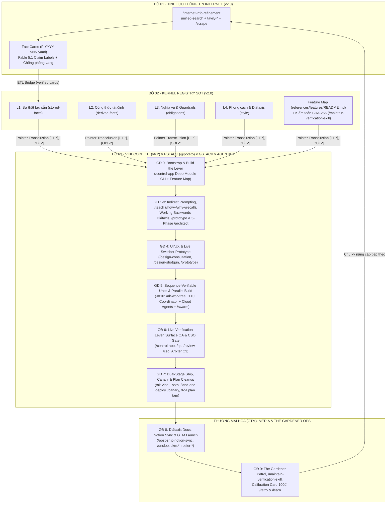
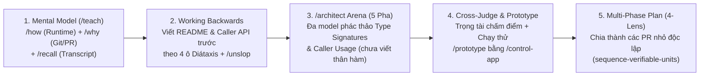
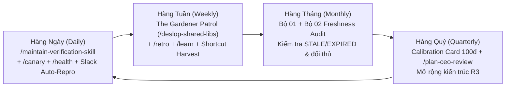

# Cẩm Nang Toàn Trình: Quy Trình Làm Sản Phẩm AI-Native Từ A Đến Z (Phiên Bản v2.2 · `Vibecode Kit v6.2 × pstack`)
**Từ Lên Ý Tưởng, Tinh Lọc Thông Tin, Chỉ Đạo Mô Hình Tiên Tiến, Lập Kế Hoạch Bằng Code, Thi Công, Kiểm Chứng Hạ Tầng Đến Ship, Deploy, Thương Mại Hóa (GTM) & Vận Hành Định Kỳ**

> [!IMPORTANT]
> **Tài liệu chuẩn hóa cấp độ Production (`v2.2` · Đã qua kiểm toán `/plan-ceo-review`):**
> - Được biên soạn qua quy trình 7 giai đoạn của **Bộ 01 ([`Bo-01-Tinh-Loc-Thong-Tin`](../Bo-01-Tinh-Loc-Thong-Tin-Internet/README.md) v2.0)**, đóng băng tại **Bộ 02 ([`Bo-02-Kernel-Registry-SOT`](../Bo-02-Kernel-Registry-SOT/README.md) v2.0)** và hợp nhất với **Bộ 03 ([`Bo-03-Vibecode-Kit-v6`](../Bo-03-Vibecode-Kit-v6/README.md) v6.2 × `pstack`)**: kết hợp **14 nguồn nghiên cứu & thực nghiệm quốc tế hạng Tier-1/Tier-2** (DORA/Google Cloud, Faros AI, Anthropic Engineering, Claude Academy, OWASP LLM 2025, Georgia Tech, cùng 2 tiểu luận nền tảng `pstack` của **Lauren Tan `@poteto`**) và kiểm kê trực tiếp **149 Skills đang kích hoạt** tại `~/.gemini/config/skills/` cùng **~210 Unique Skills** trong hệ sinh thái.
> - Liên kết trực tiếp với 9 biểu mẫu thực thi của Bộ 03 (bao gồm [`Control-App-and-Feature-Map.md`](../Bo-03-Vibecode-Kit-v6/templates/Control-App-and-Feature-Map.md), [`Blueprint-template.md`](../Bo-03-Vibecode-Kit-v6/templates/Blueprint-template.md), [`TIP-template.md`](../Bo-03-Vibecode-Kit-v6/templates/TIP-template.md) và [`RRI-template.md`](../Bo-03-Vibecode-Kit-v6/templates/RRI-template.md)).

---

## Phần I · Cơ Sở Khoa Học, Hệ Thống `pstack` (`@poteto`) & Kiến Trúc Tam Bộ Liên Thông

### 1.1. Tại sao làm sản phẩm bằng AI cần Hạ Tầng Tự Kiểm Chứng (`Verification Infrastructure`)?

Các nghiên cứu thực nghiệm quy mô lớn giai đoạn 2024–2026 và thực tế vận hành hệ thống `pstack` chỉ ra một sự thật cốt lõi: **Nếu Agent không thể tự kiểm chứng công việc của chính nó, mọi thứ khác đều vô nghĩa vì con người vẫn là nút thắt cổ chai (`bottleneck`)** (`[F-2026-012]`).

1. **Nghịch lý Năng suất AI (`The AI Productivity Paradox`):**
   - Theo **Báo cáo DORA 2025 của Google Cloud**, **90%** kỹ sư đã sử dụng AI trong công việc; AI giúp tăng tốc độ đầu ra (`Throughput`) nhưng lại có **tương quan tiêu cực với độ ổn định của phần mềm (`Stability`)** nếu thiếu rào chắn kiểm chứng (`[F-2026-003]`). Như DORA đúc kết: *"AI không sửa chữa một đội ngũ; nó khuếch đại những gì vốn có của đội ngũ đó."*
   - Theo **Báo cáo Faros AI (07/2025)** khảo sát hơn **10.000 lập trình viên trên 1.255 đội ngũ**, các nhóm dùng nhiều AI hoàn thành nhiều hơn **21%** tác vụ và gộp nhiều hơn **98%** Pull Request, nhưng **kích thước PR phình to thêm 154% (`2.54x` `[L2-pr-size-multiplier-under-high-ai]`)**, **thời gian chờ review code tăng 91%** và **số lỗi (bugs) trên mỗi lập trình viên tăng 9%** (`[F-2026-004]`).
2. **Chuẩn 5 chỉ số DORA mới (`DORA 5 Metrics`):**
   - DORA đã chính thức mở rộng từ 4 lên **5 chỉ số** bằng cách bổ sung **Tỷ lệ làm lại bản triển khai (`Deployment Rework Rate`)** bên cạnh `Deployment Frequency`, `Change Lead Time`, `Failed Deployment Recovery Time` và `Change Fail Rate` (`[F-2026-001]`).
   - Để đạt ngưỡng hiệu suất nhóm đầu ngành (`Elite`: triển khai theo yêu cầu, Lead Time `< 1 ngày`, khôi phục sự cố `< 1 giờ`, tỷ lệ lỗi thay đổi `~5%` `[F-2026-002]`, trong khi mặt bằng chung năm 2025 chỉ có `16.2%` đội ngũ deploy được theo yêu cầu `[F-2026-008]`), hệ thống bắt buộc phải có:
     - **Hạ tầng tự kiểm chứng khép kín vòng lặp (`Verification as Critical Infrastructure`)** và **Cô lập luồng chạy bằng `Git Worktree` / `Cloud Agents`** (`[F-2026-005]`, `[F-2026-006]`, `[F-2026-012]`, `[F-2026-013]`).
     - **Cổng quét bảo mật tĩnh (`Static Analysis`) và kiểm toán lỗ hổng LLM** theo chuẩn OWASP Top 10 for LLM Apps 2025 và nghiên cứu của Georgia Tech (`[F-2026-007]`).
3. **Bước chuyển hóa vai trò Kỹ sư: Từ "Người Gác Cổng" sang "Người Làm Vườn" (`The Gardener` · `@poteto` Bài 1):**
   - Trước thời đại Agent, số lượng PR hay dòng code (`LOC`) là chỉ số phù phiếm (`vanity metric`). Nhưng khi Agent vận hành trên một hạ tầng kiểm chứng chặt chẽ, lưu lượng PR lớn cho phép kỹ sư đóng vai trò **"Người làm vườn" (`The Gardener`)**: liên tục tuần tra dòng chảy PR, nhổ bỏ "cỏ dại" kiến trúc ngay từ trong trứng nước (ví dụ: một hàm tiện ích bị viết lặp lại lần thứ 3 trong tuần, hoặc lệnh tắt lint `eslint-disable` lan tràn) và chủ động refactor nền tảng ngay khi sản phẩm đang tăng trưởng nóng mà không gây downtime (`[F-2026-013]`).
   - Một nền tảng có rào chắn (`guardrails`) và đòn bẩy kiểm chứng tốt sẽ giúp cả kỹ sư lẫn người không chuyên (`non-engineers` · PM, Designer, Marketer, Ops) đóng góp tính năng an toàn, nhân **100–1000x năng suất toàn đội** (`[F-2026-012]`).

---

### 1.2. Bốn Đột Phá Phương Pháp Luận Từ Hệ Thống `pstack` (`@poteto`) Đã Tích Hợp Vào Cẩm Nang v2.2

Qua quá trình thẩm định chiến lược `/plan-ceo-review`, cẩm nang `v2.2` hợp nhất toàn bộ tinh hoa từ 2 bài viết nền tảng của `@poteto` vào trục **Tam Bộ Liên Thông**:

| Trụ cột `pstack` (`@poteto`) | Vấn đề giải quyết | Cơ chế thực thi chuẩn trong Cẩm nang v2.2 | Mã Thẻ SOT |
|---|---|---|---|
| **1. Build the Lever (`/control-app` Deep Module CLI)** | Viết hướng dẫn kiểm thử bằng chữ trong `SKILL.md` khiến Agent tốn hàng nghìn token viết script dùng 1 lần và dễ gãy | Đóng gói CLI `/control-app` theo triết lý **Deep Modules (John Ousterhout)**: subcommands ghép nối được (`progressive disclosure`), cờ `--dry-run` cho mọi lệnh có tác dụng phụ, báo lỗi chỉ rõ nguyên nhân + lệnh cần chạy tiếp theo, đầu ra `JSON`, bao phủ trọn DX (seed DB, mock auth, feature flag, snapshot DOM/a11y, chụp ảnh, đo hiệu năng) | `[F-2026-012]`, `[OBL-sdlc-2026-004]` |
| **2. Materialized Memory (`Feature Maps`)** | Khi ứng dụng phình to, Agent đốt hết context window chỉ để mò xem tính năng nằm ở đâu và làm sao đi tới màn hình đó | Duy trì bản đồ **`references/features/README.md` (`Feature Map`)**: danh mục mọi tính năng từ góc nhìn người dùng, mục đích và lệnh CLI/đường dẫn chạm tới nó. Codebase là chân lý tối thượng; Feature Map là bản nén tiết kiệm token được đồng bộ hàng ngày bằng `/maintain-verification-skill` | `[F-2026-012]`, `[OBL-sdlc-2026-004]` |
| **3. Supervising Smarter Models (`Indirect Prompting` + `/teach` + `Working Backwards`)** | Frontier Models vẫn thất bại vì (1) Đầu bài mơ hồ (`under-specified intent`) và (2) Thiếu ngữ cảnh lịch sử (`missing context`); "Plan Mode" trừu tượng tạo *ảo giác tiến độ* | - **Indirect Prompting:** Bắt Agent đọc log/thread nhiễu và diễn đạt lại bài toán bằng lời của chính nó (*"restate in your own words and in plain english"*).<br/>- **Bộ tứ `/teach = /how + /why + /recall`:** `/how` (truy vết runtime đa nhánh) + `/why` (đào lịch sử Git/PR/ticket/chat) + `/teach` (bắt Agent dạy lại trực quan để chống phán rỗng) + `/recall` (nén transcript phiên cũ).<br/>- **Working Backwards:** Viết `README`/Tutorial trước từ góc nhìn người gọi API theo 4 ô **Diátaxis** (`Tutorial`, `How-to`, `Reference`, `Explanation`) + lọc văn phong AI bằng `/unslop` | `[F-2026-014]` |
| **4. Planning with Code (`/prototype` & 5 pha `/architect`), Cloud `/swarm` & Repo Hygiene** | Chấp nhận ngay thiết kế đầu tiên của Agent hoặc review đối kháng quá đà trên giấy khiến Agent bịa rủi ro lý thuyết; quá `~10` local worktrees làm treo máy cá nhân; file plan cũ làm bẩn repo | - **`/prototype`:** Dựng 2–3 phương án chạy thật sau nút chuyển `UI Switcher`, dùng `/control-app` chụp ảnh/đo đạc chọn phương án thắng.<br/>- **5 pha `/architect`:** `Ground` -> `Sketch (Architecture Arena đa model viết Type Signatures & Caller Usage chưa có thân hàm)` -> `Cross-judge & Synthesize` -> `Implement` -> **`Scrap when wrong`** (đập đi làm lại ngay nếu phải truyền tham số vá víu, lặp workaround hoặc dùng `any`).<br/>- **Cloud Agents + `/swarm`:** Vượt trần `~10` local worktrees bằng Coordinator Bot + Cloud VM Snapshots + `/swarm` (tự động tái hiện lỗi Slack `auto-repro`).<br/>- **Repo Hygiene:** Chia thành các PR nhỏ độc lập (`sequence-verifiable-units`) gắn với `Live Verification` và **xóa bỏ file plan tạm sau khi merge** | `[F-2026-013]`, `[F-2026-015]`, `[OBL-sdlc-2026-005]` |

---

### 1.3. Kiến trúc "Tam Bộ Liên Thông × `pstack`" & Bản Đồ ~210+ Skills Trên Máy

Máy của bạn được trang bị hệ sinh thái AI-Native hoàn chỉnh gồm **149 file `SKILL.md` hoạt động trực tiếp** tại `~/.gemini/config/skills/` và **~210 Unique Skills** trong danh bạ tổng hợp (`[F-2026-010]`, `[F-2026-011]`). Toàn bộ các công cụ này vận hành xoay quanh trục xương sống **Tam Bộ Liên Thông (`Bộ 01 -> Bộ 02 -> Bộ 03`) kết hợp hạ tầng `pstack`**:



#### Phân vai trong quá trình làm sản phẩm (`Vibecode Kit v6.2 × pstack`)
| Vai trò | Người đảm nhiệm | Trách nhiệm cốt lõi | Ranh giới cấm (`Trust Boundary`) |
|---|---|---|---|
| **Chủ nhà & Người làm vườn (`Homeowner / The Gardener`)** | **Bạn (User / Engineer)** | Kiểm duyệt bài toán qua `Indirect Prompting`, nghe Agent `/teach` lại, chọn phương án qua `/prototype`, ký duyệt `Blueprint` và tuần tra dòng chảy PR để nhổ "cỏ dại" kiến trúc sớm (`[F-2026-013]`) | Không ngồi canh (`babysitting`) từng lệnh test của Agent; không chấp nhận thiết kế đầu tiên khi chưa qua `Architecture Arena` |
| **Chủ thầu / Điều phối viên (`Contractor / Coordinator Bot`)** | **AI Orchestrator** | Chạy `/how + /why + /recall`, điều phối `5-Phase /architect Arena`, chia gói `TIP` (`sequence-verifiable-units`), giữ ngữ cảnh sạch và đẩy việc nặng sang Local Worktrees hoặc `Cloud Agents + /swarm` | **Tuyệt đối không trực tiếp code sản phẩm** để giữ ngữ cảnh điều phối sạch và độc lập |
| **Thợ (`Builder / Cloud Agent`)** | **AI Coding Subagents** | Nhận gói `TIP`, cài đặt theo khung `Type Signatures` đã duyệt, tự chạy `/control-app` để `Live Verify` (chụp ảnh/video/log), sẵn sàng báo **`Scrap when wrong`** nếu phát hiện kiến trúc sai | Không sửa file ngoài phạm vi `TIP`; không dùng `any`/truyền tham số vá víu để che giấu lỗi thiết kế; quá 3 lần thất bại phải dừng (`3-Strike Rule`) |
| **Quân sư / Trọng tài (`Kongming / Arbiter C3`)** | **Cross-Model Judge** | Chấm điểm các nhánh phác thảo trong `Architecture Arena` theo rubric (`Cross-judge & Synthesize`) và nghiệm thu chéo độc lập (`PASS / CONCERNS / FAIL`) | Chỉ đọc (`read-only`), tuyệt đối không sửa code |

#### Bảng Phân tầng Rủi ro (`Risk Tiers R0 – R3`) để chọn quy trình vừa vặn
| Cấp độ | Quy mô công việc | Luồng rút gọn / mở rộng khuyến nghị |
|---|---|---|
| **`R0 · Trivial`** (5–15 phút) | Đổi câu chữ, sửa lỗi chính tả, chỉnh CSS nhỏ, hoàn tác 100% dễ dàng | `SCAN` nhanh -> `/ak-fix` hoặc sửa trực tiếp -> chạy `/control-app` verify -> `/ship`. Bỏ qua `RRI` và `Blueprint`. |
| **`R1 · Low`** (< 2 giờ, 1 TIP) | Sửa bug đơn lẻ, thêm hàm CLI nhỏ, thêm trường dữ liệu cục bộ | `Indirect Prompting` (*"Restate in your own words"*) -> `/investigate` (hoặc `/swarm` auto-repro) -> 1 `TIP` gọn -> `/freeze` + `/ak-cook` -> `/control-app` + `/qa` -> `/ship`. |
| **`R2 · Medium`** (2–5 TIPs) | Tính năng sản phẩm mới, tích hợp cổng thanh toán/API, đổi schema DB vừa | `/how + /why + /recall` -> `/teach` -> `Working Backwards (README Diátaxis)` -> `/prototype` hoặc `/architect` -> `/autoplan` (4-Lens) -> `/ak-worktree` + `/ak-cook` -> `/qa` + `/review` -> Xóa file plan tạm -> `Calibration Card`. |
| **`R3 · High / Critical`** (5+ TIPs / Sản phẩm mới từ A–Z) | Xây sản phẩm mới từ đầu, hệ thống tài chính/bảo mật, đa Thợ chạy song song (`>10 agents`) | **Chạy trọn vẹn Giai đoạn 0 đến Giai đoạn 9 dưới đây**: Bộ 01 -> Bộ 02 -> Đòn bẩy `/control-app` + `Feature Map` -> `5-Phase /architect Arena` -> `Coordinator + Cloud Agents + /swarm` -> `Independent Arbiter C3` -> `Dual-Stage Ship (Beta -> Stable)` -> Xóa plan tạm -> `/post-ship-notion-sync` -> `GTM Launch` -> `The Gardener Patrol`. |

---

## Phần II · Quy Trình 10 Giai Đoạn Làm Sản Phẩm Từ A Đến Z (Chuẩn `v2.2`)

---

### GIAI ĐOẠN 0 · Khởi Tạo Không Gian Làm Việc, Xây Đòn Bẩy `/control-app` & Bản Đồ `Feature Map` (`Bootstrap & Build the Lever`)

> [!IMPORTANT]
> **Nguyên lý "Build the Lever" (`@poteto` Bài 1 `[F-2026-012]`, `[OBL-sdlc-2026-004]`):**
> Đừng chỉ viết hướng dẫn kiểm thử bằng chữ trong `SKILL.md` (khiến Agent tốn hàng nghìn token viết script dùng một lần mỗi khi cần test). Ngay từ Giai đoạn 0, hãy đóng gói một **Agent-friendly CLI (`/control-app` hoặc `./bin/control-app`)** theo triết lý **Deep Modules của John Ousterhout** và khởi tạo bộ nhớ vật chất hóa **`references/features/README.md` (`Feature Map`)**.

#### 1. Danh mục Công cụ & Skill sử dụng
- **Quản lý Profile Skill:** [`ak-profile`](file:///Users/tuandunghoang/.gemini/config/skills/ak-profile/SKILL.md), [`ak-find-skills`](file:///Users/tuandunghoang/.gemini/config/skills/ak-find-skills/SKILL.md), [`ak-help`](file:///Users/tuandunghoang/.gemini/config/skills/ak-help/SKILL.md)
- **Khởi tạo Bộ nhớ Dự án (`GBrain` & `Feature Map`):** [`setup-gbrain`](file:///Users/tuandunghoang/.gemini/config/skills/setup-gbrain/SKILL.md), [`sync-gbrain`](file:///Users/tuandunghoang/.gemini/config/skills/sync-gbrain/SKILL.md), `references/features/README.md`
- **Kết nối Trình duyệt Thật & Điều khiển Ứng dụng:** [`open-gstack-browser`](file:///Users/tuandunghoang/.gemini/config/skills/connect-chrome/SKILL.md), [`setup-browser-cookies`](file:///Users/tuandunghoang/.gemini/config/skills/setup-browser-cookies/SKILL.md), [`ak-chrome-profile`](file:///Users/tuandunghoang/.gemini/config/skills/ak-chrome-profile/SKILL.md), [`ak-agent-browser`](file:///Users/tuandunghoang/.gemini/config/skills/ak-agent-browser/SKILL.md)
- **Cài đặt gói Marketing theo Workspace (tránh ghi đè 33 skills kỹ thuật):** Script `install-for-antigravity.sh` trong [`MASTER-SKILLS-CATALOG.md`](../Bo-03-Vibecode-Kit-v6/README.md)

#### 2. Tiêu chuẩn 6 Trụ cột Thiết kế CLI `/control-app` cho Agent (`Deep Modules`)
Mọi dự án phần mềm đều phải có một script CLI thống nhất (`./bin/control-app`) đáp ứng đủ 6 tiêu chuẩn sau (`[OBL-sdlc-2026-004]`):
1. **Dễ ghép nối & Hé lộ chức năng tăng dần (`Composable & Progressive Disclosure`):** Dùng cấu trúc `subcommands` rõ ràng (`control-app db seed`, `control-app auth login-as`, `control-app flag set`, `control-app ui snapshot`, `control-app perf measure`).
2. **An toàn tuyệt đối với `--dry-run`:** Mọi lệnh có nguy cơ gây tác dụng phụ (ghi DB, đổi cấu hình, đẩy dữ liệu) bắt buộc hỗ trợ cờ `--dry-run`.
3. **Thông báo lỗi có tính chỉ dẫn hành động (`Actionable Error Messages`):** Khi gặp lỗi, CLI phải in rõ nguyên nhân gốc và **chỉ dẫn trực tiếp cho Agent biết cần chạy lệnh gì tiếp theo** (ví dụ: `ERROR: Test DB not seeded. Run: ./bin/control-app db seed --preset=minimal`).
4. **Đầu ra máy đọc được (`Machine-readable JSON`) & `--help` chi tiết:** Mặc định hỗ trợ `--json` để Agent parse kết quả không tốn token đọc chữ thô.
5. **Bao phủ trọn vẹn Trải nghiệm Dev (`Full DX Coverage`):**
   - `db seed`: Khởi tạo dữ liệu mẫu tất định (`deterministic fixtures`).
   - `auth impersonate`: Giả lập đăng nhập với bất kỳ vai trò/test user nào (`admin`, `free-tier`, `expired-card`).
   - `flag toggle`: Bật/tắt `feature flag` ngay trong phiên kiểm thử.
   - `ui dom-tree` & `ui screenshot`: Xuất cây giao diện (`DOM / Accessibility tree`), chụp ảnh màn hình và quay video thao tác.
   - `perf probe`: Đo thời gian phản hồi API, bộ nhớ và tốc độ khung hình.
6. **Liên kết trực tiếp với Bản đồ Tính năng (`Feature Map` · `references/features/README.md`):**
   - Lập bảng tra cứu nhanh từ góc nhìn người dùng: `Tên tính năng | Mục đích | Route / URL | Lệnh ./bin/control-app để nhảy thẳng tới trạng thái đó`.
   - Giúp Agent tiết kiệm hàng chục nghìn token vì không phải đọc mò toàn bộ codebase để tìm đường vào một màn hình.

#### 3. Thao tác thực thi chuẩn
```bash
# 1. Kiểm tra và bật skill profile phù hợp trên Antigravity IDE
/ak-profile status
/ak-profile dev

# 2. Cài bộ 107 skills Marketing (ckm:*) riêng vào workspace dự án (nếu cần):
bash /Users/tuandunghoang/projects/setup/claudekit-marketing/install-for-antigravity.sh --workspace /duong/dan/du-an

# 3. Khởi tạo bộ nhớ GBrain, nhập cookie trình duyệt và tạo khung Feature Map:
/setup-gbrain
/setup-browser-cookies
mkdir -p references/features && touch references/features/README.md
```

---

### GIAI ĐOẠN 1 · Lên Ý Tưởng, Kỹ Thuật `Indirect Prompting` & Khám Phá Sản Phẩm (`Ideation, Indirect Prompting & Product Discovery`)

> [!TIP]
> **Hai điểm mù của Frontier Models & Kỹ thuật "In your own words" (`@poteto` Bài 2 `[F-2026-014]`):**
> Dù thông minh đến đâu, các mô hình AI hiện đại vẫn thất bại vì 2 lý do: **(1) Đầu bài mơ hồ (`under-specified intent`)** và **(2) Thiếu ngữ cảnh lịch sử/hệ thống (`missing context`)**. Thay vì áp đặt ngay giả thuyết chủ quan của con người (dễ dẫn Agent đi lệch hướng theo định kiến sai) hoặc cầm tay chỉ việc từng dòng, hãy mở đầu bằng **Indirect Prompting**: yêu cầu Agent đọc nguồn thông tin nhiễu (ý tưởng thô, thread báo lỗi, phàn nàn khách hàng, log) và **diễn đạt lại bản chất vấn đề bằng lời của chính nó (*"restate in your own words and in plain english"*)**.

#### 1. Danh mục Công cụ & Skill sử dụng
| Nhiệm vụ | Skill kích hoạt | Đầu ra cụ thể |
|---|---|---|
| **Nén thông tin nhiễu & Bắt lỗi hiểu sai đầu bài (`Indirect Prompting`)** | Prompt *"Restate the problem in your own words and in plain English"* + [`/ak-fable-thinking`](file:///Users/tuandunghoang/.gemini/config/skills/ak-fable-thinking/SKILL.md) | Bản tóm tắt bài toán có cấu trúc bằng ngôn ngữ tự nhiên, phơi bày mọi chỗ hiểu nhầm trước khi viết bất kỳ dòng code nào |
| **Phản biện ý tưởng kiểu Y Combinator (Startup mode) hoặc tháo gỡ điểm nghẽn (Builder mode)** | [`/office-hours`](file:///Users/tuandunghoang/.gemini/config/skills/office-hours/SKILL.md) | Bản thẩm định bài toán, phân tích 3 phương án tiếp cận và chốt `Accepted Outcome` |
| **Brainstorm tính năng & Phân tích đánh đổi (`Trade-off Analysis`)** | [`/ak-brainstorm`](file:///Users/tuandunghoang/.gemini/config/skills/ak-brainstorm/SKILL.md) | Ma trận so sánh giải pháp + khuyến nghị kiến trúc sơ bộ |
| **Phỏng vấn sâu từng quyết định với Quân sư cấp cao** | Subagent `advisor` hoặc `kongming` | Bản tư vấn chiến lược (những gì nên làm, nên tránh, chỉ số thành công) |
| **Xác định chân dung khách hàng mục tiêu (`Customer Persona`) & Ý tưởng tăng trưởng** | `ckm:persona`, `ckm:marketing-ideas`, `ckm:marketing-psychology` | Hồ sơ phân khúc khách hàng (`ICP`), hành vi mua hàng và đòn bẩy tâm lý |

#### 2. Quy trình thực hiện từng bước
1. **Bước 1.1 · Thực thi `Indirect Prompting` ("In your own words"):**
   Đưa toàn bộ dữ liệu đầu vào thô (ghi chú cuộc họp, phản hồi khách hàng, thread Slack, log lỗi) cho Agent và yêu cầu:
   > *"Đọc toàn bộ thông tin trên. Chưa đề xuất giải pháp hay viết code vội. Hãy diễn đạt lại bản chất bài toán, ràng buộc ngầm và kết quả mong đợi bằng lời của chính bạn một cách rõ ràng, dễ hiểu nhất (in your own words and in plain English)."*
2. **Bước 1.2 · Mở phiên YC Office Hours (`/office-hours`):**
   Sau khi xác nhận Agent đã hiểu đúng 100% bài toán, gõ lệnh `/office-hours` để ép ý tưởng qua các câu hỏi thực tế: Ai là người trả tiền đầu tiên? Hiện tại họ đang giải quyết thủ công thế nào? Tại sao giải pháp hiện tại thất bại? (`[F-2026-009]`).
3. **Bước 1.3 · Khóa Chân dung Khách hàng (`ICP`):**
   Chạy `ckm:persona` để định nghĩa rõ phân khúc người dùng mục tiêu, nỗi đau (`Pain points`), rào cản chuyển đổi (`Switching costs`) và kênh tiếp cận.
4. **Cổng qua màn (`Exit Gate 1`):** Có bản **Product Problem Brief** đã qua bước `Restate in your own words` không còn độ lệch ý định giữa Người và AI, xác định rõ phân khúc khách hàng đầu tiên (`Beachhead Market`).

---

### GIAI ĐOẠN 2 · Nghiên Cứu Thị Trường, Đối Thủ, Tài Chính & Đóng Băng Nguồn Sự Thật (`Research, Financial Modeling & SOT`)

Sau khi khóa bài toán, tuyệt đối không để AI tự "bịa" số liệu thị trường, giá bán đối thủ hay quy định pháp lý từ trí nhớ huấn luyện (`PRIOR`). Bạn bắt buộc chạy **Bộ 01 (`internet-info-refinement`)** nối sang **Bộ 02 (`kernel-registry-sot`)**.

#### 1. Danh mục Công cụ & Skill sử dụng
| Nhiệm vụ | Skill / Công cụ kích hoạt | Đầu ra cụ thể |
|---|---|---|
| **Tinh lọc thông tin Internet thành thẻ sự thật nguyên tử (Bộ 01)** | [`/internet-info-refinement`](file:///Users/tuandunghoang/.gemini/config/skills/internet-info-refinement/SKILL.md) | `brief.md`, `source-log.csv`, `fact-cards/F-YYYY-NNN.yaml`, `conflict-queue.md`, `report-final.md` |
| **Tìm kiếm đa tín hiệu (18 API Keys xoay vòng)** | MCP `unified-search` (`web_search`, `web_extract`, `pool_status`) | Dữ liệu web thô theo chế độ `company`, `legal`, `academic`, `news`, `code`, `deep` |
| **Lập bản đồ trang web & Cào sâu tài liệu đối thủ** | [`tavily-map`](file:///Users/tuandunghoang/.gemini/config/skills/tavily-map/SKILL.md), [`tavily-extract`](file:///Users/tuandunghoang/.gemini/config/skills/tavily-extract/SKILL.md), [`tavily-crawl`](file:///Users/tuandunghoang/.gemini/config/skills/tavily-crawl/SKILL.md), [`tavily-research`](file:///Users/tuandunghoang/.gemini/config/skills/tavily-research/SKILL.md) | Cấu trúc URL toàn trang và bảng giá/tính năng chi tiết của đối thủ |
| **Cào dữ liệu từ trang yêu cầu đăng nhập & đóng gói thành Skill** | [`/scrape`](file:///Users/tuandunghoang/.gemini/config/skills/scrape/SKILL.md) -> [`/skillify`](file:///Users/tuandunghoang/.gemini/config/skills/skillify/SKILL.md) | Trích xuất dữ liệu qua trình duyệt Aside đã đăng nhập và lưu thành kịch bản tự động ~200ms |
| **Phân tích đối thủ cạnh tranh & Chiến lược giá** | `ckm:competitor`, `ckm:marketing-research`, `ckm:pricing-strategy` | Battlecards đối thủ, phân tích khoảng trống thị trường và cấu trúc gói giá (`Freemium / Tiered / Usage-based`) |
| **Đóng băng Nguồn Sự Thật Chuẩn (Bộ 02)** | [`/kernel-registry-sot`](file:///Users/tuandunghoang/.gemini/config/skills/kernel-registry-sot/SKILL.md), [`/ak-graphify`](file:///Users/tuandunghoang/.gemini/config/skills/ak-graphify/SKILL.md), [`/sync-gbrain`](file:///Users/tuandunghoang/.gemini/config/skills/sync-gbrain/SKILL.md) | Kho `kernel-registry/` gồm `L1` (sự thật), `L2` (công thức Python tất định), `L3` (pháp lý & guardrails), `L4` (phong cách) kèm mã băm `SHA-256` |
| **Lập Mô hình Tài chính & Thuyết trình Đầu tư (Office 4-Layer)** | [`xlsx-financial-modeler`](file:///Users/tuandunghoang/.gemini/config/skills/xlsx-financial-modeler/SKILL.md), [`executive-memo-writer`](file:///Users/tuandunghoang/.gemini/config/skills/executive-memo-writer/SKILL.md), [`pptx-executive-deck`](file:///Users/tuandunghoang/.gemini/config/skills/pptx-executive-deck/SKILL.md), [`docx-enterprise-author`](file:///Users/tuandunghoang/.gemini/config/skills/docx-enterprise-author/SKILL.md) | File Excel `.xlsx` (Unit Economics, 3-Statement, DCF), Bản ghi nhớ 6-Pager Amazon Memo, Slide `.pptx` cho Ban Giám đốc |

#### 2. Quy trình thực hiện từng bước
1. **Bước 2.1 · Chạy `/internet-info-refinement` để thu thập dữ liệu:**
   - Khởi tạo `brief.md`, dùng `unified-search` (chế độ `company`, `legal`, `deep`) kết hợp lọc ngữ cảnh cô lập `PTC` qua `/tmp/` để trích xuất các thẻ `Fact Cards` (`OBSERVED`, `DERIVED`).
   - Kiểm tra chống phòng vang (`independent_origin_count`) và giải quyết mọi mâu thuẫn số liệu qua thẻ `Decision Brief D<N>` trong `conflict-queue.md`.
   - Chạy vòng lặp `Constraint Loop` đảm bảo tỷ lệ thẻ `verified >= 40%` và `0` xung đột treo.
2. **Bước 2.2 · Chuyển giao sang Bộ 02 (`/kernel-registry-sot`):**
   - Nhập toàn bộ thẻ `Fact Cards` có `bo02_bridge.export_ready: true` vào `registry/stored-facts/` (`L1`).
   - Thiết lập các công thức tính toán biên lợi nhuận, biểu phí, định mức BOM vào `registry/derived-facts/` (`L2` · bắt buộc tính bằng script tất định `eval_l2.py`, cấm AI nhẩm tính).
   - Lưu các quy định pháp luật và rào chắn kỹ thuật (Nghị định 13, tiêu chuẩn OWASP, kỷ luật `pstack`) vào `obligations/` (`L3`).
   - Lưu giọng văn thương hiệu vào `style/` (`L4`).
3. **Bước 2.3 · Dựng Mô hình Kinh doanh & Hồ sơ Phê duyệt:**
   - Gọi `xlsx-financial-modeler` để xuất bảng tính `.xlsx` động dự phóng dòng tiền, CAC/LTV và điểm hòa vốn.
   - Gọi `executive-memo-writer` hoặc `pptx-executive-deck` để xuất tài liệu trình duyệt chủ trương đầu tư.
4. **Cổng qua màn (`Exit Gate 2`):** Kho `kernel-registry/` đạt trạng thái `FRESH` 100% mã băm `SHA-256`, có danh sách mã con trỏ `[L1-*]`, `[L2-*]`, `[OBL-*]`, `[L4-*]` sẵn sàng nhúng vào bản thiết kế kỹ thuật.

---

### GIAI ĐOẠN 3 · Xây Dựng Mental Model Hai Chiều (`/teach`), Thiết Kế Ngược `Diátaxis` & Lập Kế Hoạch Bằng Code (`Mental Model, Working Backwards & 5-Phase /architect`)

> [!WARNING]
> **Cảnh báo từ `@poteto` (Bài 2 `[F-2026-014]`, `[F-2026-015]`): Tránh "Ảo giác Tiến độ" (`Illusion of Progress`) của Plan Mode truyền thống!**
> Các bản kế hoạch văn bản trừu tượng thường quá chi tiết về tiểu tiết cài đặt (`over-specify implementation`) nhưng lại bỏ trống trải nghiệm người gọi/người dùng (`under-specify caller DX`). Tệ hơn, việc review đối kháng quá đà trên một bản kế hoạch trừu tượng sẽ ép Agent tự bịa ra các rủi ro lý thuyết không bao giờ xảy ra trong thực tế để phòng thủ.
> **Giải pháp chuẩn v2.2:** Kết hợp **Bộ tứ `/teach = /how + /why + /recall`**, **Working Backwards (`Readme-Driven + Diátaxis + /unslop`)** và **Lập kế hoạch bằng Code thực nghiệm (`/prototype` + 5 pha `/architect` Arena)** trước khi khóa `Blueprint` qua `/autoplan`.

#### 1. Danh mục Công cụ & Skill sử dụng
| Nhiệm vụ | Skill / Quy trình kích hoạt | Đầu ra cụ thể |
|---|---|---|
| **Xây dựng Mental Model hai chiều (`/teach = /how + /why + /recall`)** | `/how` ([`/ak-scout`](file:///Users/tuandunghoang/.gemini/config/skills/ak-scout/SKILL.md) fan-out) + `/why` (`git log -S` / PR / ticket / chat) + `/recall` ([`/context-restore`](file:///Users/tuandunghoang/.gemini/config/skills/context-restore/SKILL.md)) -> **`/teach`** | Bản giải thích trực quan cơ chế hiện tại (`how`), nguyên nhân lịch sử (`why`), trạng thái phiên trước (`recall`) và chứng minh bằng dữ liệu thực tế vì sao thiết kế mới tốt hơn |
| **Thiết kế Ngược từ README & Khung 4 Ô Diátaxis (`Working Backwards`)** | `/technical-writing` (Readme-Driven Development theo 4 ô **Diátaxis**) + `/unslop` | Bản `README.md` / `Tutorial` viết từ góc nhìn người gọi API trước khi viết code cài đặt, đã gọt sạch văn phong AI rườm rà |
| **Đấu trường Kiến trúc 5 Pha (`/architect` Arena)** | [`/ak-plan`](file:///Users/tuandunghoang/.gemini/config/skills/ak-plan/SKILL.md) (`--ultra --advice`) + Subagent `kongming` + `/codex` | (1) `Ground` -> (2) `Sketch Type Signatures & Caller Usage` đa model -> (3) `Cross-judge & Synthesize` -> (4) `Implement against sketch` -> (5) `Scrap when wrong` |
| **Dịch ngược sản phẩm mẫu / đối thủ (nếu cần học kiến trúc)** | [`/reverse-engineer-anything`](file:///Users/tuandunghoang/.gemini/config/skills/reverse-engineer-anything/SKILL.md) (MCP `rea`) | Báo cáo phân tích cấu trúc gói tin, API, bundle JS/Electron/Mobile của ứng dụng mẫu |
| **Chuỗi Duyệt Kế Hoạch Tự Động 4 Lăng Kính (`4-Lens Gate`)** | [`/autoplan`](file:///Users/tuandunghoang/.gemini/config/skills/autoplan/SKILL.md) ([`/plan-ceo-review`](file:///Users/tuandunghoang/.gemini/config/skills/plan-ceo-review/SKILL.md) -> [`/plan-design-review`](file:///Users/tuandunghoang/.gemini/config/skills/plan-design-review/SKILL.md) -> [`/plan-devex-review`](file:///Users/tuandunghoang/.gemini/config/skills/plan-devex-review/SKILL.md) -> [`/plan-eng-review`](file:///Users/tuandunghoang/.gemini/config/skills/plan-eng-review/SKILL.md)) | Bản kế hoạch thực thi chia theo `sequence-verifiable-units` đã qua 4 màng lọc: CEO -> UI/UX -> DX -> Eng |

#### 2. Quy trình 5 Bước Thiết kế Kiến trúc Kỷ luật Cao (`v2.2`)



1. **Bước 3.1 · Xây dựng Mental Model Hai Chiều (`/teach = /how + /why + /recall` `[F-2026-014]`):**
   - **`/how` (Truy vết cơ chế Runtime):** Kích hoạt `/ak-scout` (tự động fan-out các explorer agents chạy song song nếu hệ thống trải rộng trên nhiều thư mục/service) và đọc `references/features/README.md` (`Feature Map`).
   - **`/why` (Truy tìm nguyên nhân lịch sử & ý đồ thiết kế):** Vì code chỉ cho biết *cái gì đang chạy*, không cho biết *tại sao lại viết như vậy*, Agent bắt buộc truy vấn song song `git log -S`, PR comments, ticket, tài liệu thiết kế và log lỗi cũ để tránh đập nhầm một "hàng rào Chesterton" (`Chesterton's fence`).
   - **`/recall` (Rút trích ngữ cảnh phiên cũ):** Dùng `/context-restore` hoặc đọc `transcript.jsonl` để nén trạng thái phiên làm việc trước thành bản tóm tắt gọn nhẹ nạp vào phiên mới.
   - **`/teach` (Bắt Agent dạy lại cho bạn):** Yêu cầu Agent giải thích trực quan (kèm sơ đồ ASCII/Mermaid) và chứng minh bằng dữ liệu thực tế vì sao phương án của nó tốt hơn hiện tại. Việc bắt Agent "dạy lại" chính là cơ chế ép Agent phải đọc code thật thay vì *"phán tự tin nhưng rỗng"* (`confidently hallucinating`).
2. **Bước 3.2 · Đi Ngược từ README & Khung 4 Ô Diátaxis (`Working Backwards` + `/unslop` `[F-2026-014]`):**
   - Trước khi thiết kế chi tiết bên trong module/package, hãy viết `README.md` từ góc nhìn **người gọi API (`Caller Perspective`)** theo đúng **4 ô của khung Diátaxis**:
     1. **`Tutorial` (Hướng dẫn nhập môn):** Bài thực hành từng bước giúp người mới chạy thành công trong 5 phút.
     2. **`How-to Guide` (Hướng dẫn giải quyết tác vụ):** Công thức cụ thể để xử lý các bài toán thực tế.
     3. **`Reference` (Tài liệu tra cứu chuẩn):** Chữ ký hàm, kiểu dữ liệu, mã lỗi và cờ CLI chính xác 100%.
     4. **`Explanation` (Giải thích kiến trúc):** Lý do thiết kế, các đánh đổi (`trade-offs`) và giới hạn hệ thống.
   - Chạy quy tắc `/unslop` để cắt bỏ mọi tính từ sáo rỗng của AI, giữ lại văn phong kỹ thuật súc tích.
3. **Bước 3.3 · Chạy 5 Pha Kỷ Luật của `/architect` (`Measure a hundred times, cut once` `[F-2026-015]`):**
   - **Pha 1 · `Ground`:** Dựa trên kết quả `/how` và `/why`, khóa quyền sở hữu dữ liệu (`ownership`), bất biến hệ thống (`invariants`) và các con trỏ Bộ 02 (`[L1-*]`, `[L2-*]`, `[OBL-*]`).
   - **Pha 2 · `Sketch (Architecture Arena)`:** Mở đấu trường đa nhánh/đa model (`--ultra`). Yêu cầu mỗi nhánh độc lập phác thảo **Type Signatures & Caller Usage Sketch** (chỉ viết khung kiểu dữ liệu `interface/type/schema` và đoạn code minh họa nơi gọi hàm, **tuyệt đối chưa viết thân hàm**).
   - **Pha 3 · `Cross-judge & Synthesize`:** Dùng một model độc lập (ví dụ `Kongming` hoặc `/codex`) làm trọng tài chấm điểm các bản phác thảo theo rubric (độ gọn của kiểu dữ liệu, khả năng bắt lỗi lúc compile, độ dễ hiểu ở nơi gọi) và tổng hợp thành bản thiết kế mạnh nhất.
   - **Pha 4 · `Implement against the sketch`:** Thử nghiệm lắp logic vào khung chữ ký hàm hoặc dựng `/prototype` chạy thật.
   - **Pha 5 · `Scrap when wrong` (Sẵn sàng đập đi làm lại):** Nếu khi bắt tay vào code thật phát hiện phải truyền thêm tham số vá víu qua nhiều tầng (`pass-through parameters`), lặp lại một workaround ở nhiều chỗ, hoặc phải dùng `any` / ép kiểu cưỡng bức (`as unknown as X`) · **bắt buộc DỪNG LẠI và đập đi phác thảo lại**, vì đó là bằng chứng thực nghiệm cho thấy kiến trúc đã sai (`[OBL-sdlc-2026-005]`).
4. **Bước 3.4 · Xuất Kế hoạch Thực thi Đa Giai đoạn (`Multi-phase Plan`) & Duyệt 4 Lăng Kính (`/autoplan`):**
   - Chỉ xuất ra bản plan thực thi *sau khi* kiến trúc đã được chứng minh qua `Type Sketch` hoặc `/prototype`.
   - Chia bản kế hoạch thành các **đơn vị PR nhỏ có thể kiểm chứng độc lập (`sequence-verifiable-units`)**, gắn từng `REQ-ID` với câu lệnh **`Live Verification`** qua `/control-app` ("chỉ pass unit test là chưa đủ, phải chạy code thật") và chạy `/autoplan` (`CEO -> Design -> DX -> Eng`).
5. **Cổng qua màn (`Exit Gate 3`):** Bạn xác nhận **APPROVED** cho `Blueprint` (đã có `Type Sketch` thắng cuộc trong `Architecture Arena` và danh sách `sequence-verifiable-units`).

---

### GIAI ĐOẠN 4 · Thiết Kế Hệ Thống Giao Diện, Thương Hiệu & Dựng `/prototype` Có Nút Chuyển (`UI/UX Design & Live Prototype Switcher`)

> [!TIP]
> **Playbook `/prototype` (`@poteto` Bài 2 `[F-2026-015]`):**
> Với các luồng tương tác hoặc giao diện quan trọng, đừng tranh cãi trên bản mô tả bằng chữ. Hãy dựng nhanh **2–3 phương án thiết kế/UI chạy thật ẩn sau một nút chuyển trực tiếp trên màn hình (`Live UI Switcher`)**, dùng `/control-app` chạy thật, chụp ảnh/quay video và đo đạc để chọn phương án chiến thắng bằng bằng chứng thực nghiệm.

#### 1. Danh mục Công cụ & Skill sử dụng
| Nhiệm vụ | Skill kích hoạt | Đầu ra cụ thể |
|---|---|---|
| **Tư vấn & Khởi tạo Hệ thống Thiết kế (`DESIGN.md`)** | [`/design-consultation`](file:///Users/tuandunghoang/.gemini/config/skills/design-consultation/SKILL.md) | File `DESIGN.md` chuẩn hóa bảng màu, cặp font chữ (`Typography`), khoảng cách (`Spacing`), chuyển động và bản xem trước HTML |
| **Bắn thử nhiều phương án giao diện & Dựng `/prototype` Switcher** | [`/design-shotgun`](file:///Users/tuandunghoang/.gemini/config/skills/design-shotgun/SKILL.md) + Playbook `/prototype` | 2–3 biến thể UI sống ẩn sau thanh gạt `Variant A / B / C` trên cùng một route, được kiểm thử trực tiếp bằng `./bin/control-app` |
| **Chuyển thiết kế chốt thành HTML/CSS chất lượng Production** | [`/design-html`](file:///Users/tuandunghoang/.gemini/config/skills/design-html/SKILL.md) | Mã nguồn HTML/CSS chuẩn Pretext-native, đáp ứng đa màn hình (`Responsive`) |
| **Thư viện 161 bảng màu, 57 cặp font & 99 quy tắc UX** | [`/ak-ui-ux-pro-max`](file:///Users/tuandunghoang/.gemini/config/skills/ak-ui-ux-pro-max/SKILL.md), [`/ak-frontend-design`](file:///Users/tuandunghoang/.gemini/config/skills/ak-frontend-design/SKILL.md), [`/ak-ui-styling`](file:///Users/tuandunghoang/.gemini/config/skills/ak-ui-styling/SKILL.md) | Hệ thống Component chuẩn `shadcn/ui` (Radix UI + Tailwind CSS), hỗ trợ Dark Mode và Accessibility |
| **Thiết kế Nhận diện Thương hiệu, Logo, Banner & Slide** | `ckm:brand`, `ckm:logo-design`, `ckm:banner-design`, `ckm:cip-design`, `rosier-design`, `huashu-design` | Bộ quy chuẩn thương hiệu, Logo, Ấn phẩm nhận diện và Design Tokens |
| **Vẽ Sơ đồ Kiến trúc & Luồng Nghiệp vụ tương tác** | [`/diagram`](file:///Users/tuandunghoang/.gemini/config/skills/diagram/SKILL.md), [`generative_ui`](file:///Users/tuandunghoang/.gemini/antigravity/builtin/skills/generative_ui/SKILL.md) | Bộ 3 file sơ đồ (`.mmd` Mermaid + `.excalidraw` chỉnh sửa được + ảnh `.svg`/`.png`) và Widget HTML tương tác |

#### 2. Quy trình thực hiện từng bước
1. Chạy `/design-consultation` để thiết lập file `DESIGN.md` ở thư mục gốc của dự án (và liên kết vào kho `style/` `L4` của Bộ 02).
2. Với các màn hình quan trọng nhất (Landing Page, Dashboard chính, Màn hình Checkout), chạy `/design-shotgun` kết hợp `/prototype`: dựng 2–3 phương án ẩn sau nút chuyển `UI Switcher` (`?variant=a|b|c`), dùng `./bin/control-app ui screenshot` chụp lại toàn bộ trạng thái (`Loading`, `Empty`, `Error`, `Success`) để bạn chọn phương án thắng cuộc, sau đó xóa bỏ các nhánh nháp thua cuộc.
3. **Cổng qua màn (`Exit Gate 4`):** Có file `DESIGN.md` và biến thể UI chiến thắng đã được kiểm chứng thực nghiệm qua `/control-app`.

---

### GIAI ĐOẠN 5 · Chia Đơn Vị Khả Kiểm (`Sequence-Verifiable Units`), Điều Phối Worktree / Cloud `/swarm` & Thi Công (`Task Graph & Parallel Build`)

Đây là **Bước 5 (`TASK GRAPH`) -> Bước 6 (`BUILD`)** của **Bộ 03 (`vibecode-kit-v6` v6.2)**, được nâng cấp với quy tắc **Trần Phần Cứng `~10 Local Worktrees` vs. `Coordinator + Cloud Agents + /swarm`** (`[F-2026-013]`) và kỷ luật **`Scrap when wrong`** (`[F-2026-015]`).

#### 1. Danh mục Công cụ & Skill sử dụng
| Nhiệm vụ | Skill kích hoạt | Đầu ra cụ thể |
|---|---|---|
| **Cô lập thư mục làm việc cục bộ (`<= 10 Agents đồng thời`)** | [`/ak-worktree`](file:///Users/tuandunghoang/.gemini/config/skills/ak-worktree/SKILL.md), [`/ak-orchestrate`](file:///Users/tuandunghoang/.gemini/config/skills/ak-orchestrate/SKILL.md) | Thư mục `.worktrees/builder-<id>/` trên nhánh riêng với cơ chế `Disjoint File Ownership` (không đụng độ file) |
| **Mở rộng quy mô Đám mây (`> 10 Agents đồng thời · Cloud Agents & /swarm`)** | Coordinator Bot + Cloud VM Snapshots + `/swarm` (`[F-2026-013]`) | Đẩy việc nặng sang các máy ảo Cloud có snapshot khởi động tức thì và màn hình ảo thật để quay video/chụp ảnh không làm nghẽn RAM/Port/Ổ cứng máy cá nhân |
| **Khóa phạm vi thư mục & Chặn lệnh phá hủy (`Safety Guardrails`)** | [`/freeze`](file:///Users/tuandunghoang/.gemini/config/skills/freeze/SKILL.md), [`/careful`](file:///Users/tuandunghoang/.gemini/config/skills/careful/SKILL.md), [`/guard`](file:///Users/tuandunghoang/.gemini/config/skills/guard/SKILL.md), [`/unfreeze`](file:///Users/tuandunghoang/.gemini/config/skills/unfreeze/SKILL.md) | Chặn chỉnh sửa ngoài thư mục được giao trong `TIP` và cảnh báo trước lệnh nguy hiểm (`rm -rf`, `DROP TABLE`) |
| **Thi công Tính năng theo `Type Sketch` & TDD (`Engine chính`)** | [`/ak-cook`](file:///Users/tuandunghoang/.gemini/config/skills/ak-cook/SKILL.md) (`--tdd --auto --advice`) | Thay thân hàm rỗng trong `Type Sketch` bằng logic thật + Unit/Integration Tests + kiểm chứng sống bằng `./bin/control-app` |
| **Skill Chuyên ngành Frontend, Backend, DB, Mobile & AI/MCP** | [`/ak-frontend-development`](file:///Users/tuandunghoang/.gemini/config/skills/ak-frontend-development/SKILL.md), [`/ak-backend-development`](file:///Users/tuandunghoang/.gemini/config/skills/ak-backend-development/SKILL.md), [`/ak-databases`](file:///Users/tuandunghoang/.gemini/config/skills/ak-databases/SKILL.md), [`/ak-mobile-development`](file:///Users/tuandunghoang/.gemini/config/skills/ak-mobile-development/SKILL.md), [`/ak-mcp-builder`](file:///Users/tuandunghoang/.gemini/config/skills/ak-mcp-builder/SKILL.md), [`gemini-api-dev`](file:///Users/tuandunghoang/.gemini/config/plugins/gemini-api/skills/gemini-api-dev/SKILL.md) | Mã nguồn chuẩn Production cho React/Next.js/TanStack, Node/Python/Go, PostgreSQL/MongoDB, iOS/Android, Gemini SDK & MCP Server |
| **Lưu & Chuyển giao Ngữ cảnh giữa các ca làm việc (`Handoff` & `/recall`)** | [`/context-save`](file:///Users/tuandunghoang/.gemini/config/skills/context-save/SKILL.md), [`/context-restore`](file:///Users/tuandunghoang/.gemini/config/skills/context-restore/SKILL.md), [`/ak-handoff`](file:///Users/tuandunghoang/.gemini/config/skills/ak-handoff/SKILL.md), [`/ak-watzup`](file:///Users/tuandunghoang/.gemini/config/skills/ak-watzup/SKILL.md) | Bản hợp đồng bàn giao 9 mục đã tự động che mật khẩu (`<REDACTED:TYPE>`) và chỉ rõ `First safe step` |

#### 2. Năm kỷ luật bắt buộc khi Build (`v2.2`)
1. **Chia nhỏ thành các `Sequence-Verifiable Units` (`TIP`):** Mỗi gói `TIP` phải tương ứng với một PR nhỏ độc lập, liệt kê rõ danh sách file được phép chạm tới (`Scope Freeze`) và **bắt buộc gắn với lệnh `Live Verification` qua `./bin/control-app`** ("chỉ pass unit test là chưa đủ, phải chạy code thật" `[F-2026-015]`).
2. **Quy tắc Định tuyến Hạ tầng Song song (`<= 10 Local Worktrees` vs. `> 10 Cloud Agents` `[F-2026-013]`):**
   - **Từ 1 đến 10 Agents đồng thời:** Dùng `/ak-worktree` và `/ak-orchestrate` ngay trên máy cá nhân với quyền sở hữu file rời nhau (`Disjoint File Ownership`).
   - **Trên 10 Agents đồng thời (hoặc khi chạy `/swarm` săn lỗi):** Không mở thêm `git worktree` cục bộ để tránh tràn ổ cứng và xung đột port/DB/RAM. Hãy dùng **Coordinator Bot** (giữ context sạch) đẩy các gói `TIP` sang **Cloud Agents** (mỗi agent chạy trên VM có snapshot khởi động tức thì và màn hình ảo riêng để chụp ảnh/quay video kiểm chứng).
3. **Kỷ luật `Scrap when wrong` (Đập đi làm lại ngay khi lộ mùi kiến trúc sai `[F-2026-015]`, `[OBL-sdlc-2026-005]`):**
   Khi Thợ điền thân hàm vào `Type Sketch` đã duyệt ở Giai đoạn 3, nếu phát hiện 1 trong 3 dấu hiệu thực nghiệm sau:
   - Phải truyền thêm tham số vá víu xuyên qua nhiều tầng không liên quan (`pass-through parameters`);
   - Phải copy-paste cùng một đoạn workaround ở nhiều nơi;
   - Phải dùng `any`, `@ts-ignore` hoặc ép kiểu cưỡng bức để code chạy được;
   -> Thợ **bắt buộc DỪNG LẠI**, báo cáo Chủ thầu hủy nhánh code nháp và quay lại Pha 2 của `/architect` để sửa `Type Sketch`.
4. **Luật 3 Lần Thất Bại (`3-Strike Failure Escalation`):** Nếu Thợ chạy test hoặc sửa một lỗi thất bại 3 lần liên tiếp, bắt buộc **DỪNG LẠI NGAY**, gọi Quân sư `Kongming` (`--advice`) hoặc báo cáo Chủ thầu kèm nguyên văn log lỗi.
5. **Nộp `Completion Report` kèm Dấu vân tay (`WTREE_FINGERPRINT`) & Cập nhật `Feature Map`:**
   Mỗi khi xong 1 `TIP`, Thợ phải chạy kiểm thử, cập nhật đường dẫn/lệnh CLI mới vào `references/features/README.md` (`Feature Map`) và ghi nhận mã băm trạng thái cây thư mục (`git rev-parse HEAD` + `git status --porcelain`) ở trạng thái `FRESH`.

---

### GIAI ĐOẠN 6 · Kiểm Chứng Hạ Tầng Khép Kín (`/control-app` & `/swarm`), QA Bề Mặt Thật, Review & Bảo Mật (`Close-the-Loop Verification & CSO Gate`)

Đây là **Bước 7 (`VERIFY`)** của **Bộ 03 (`vibecode-kit-v6` v6.2)** kết hợp triết lý **Verification is All You Need (`@poteto` Bài 1 `[F-2026-012]`, `[F-2026-013]`)** · giải quyết triệt để điểm nghẽn `+91% thời gian review` và `+9% bug` của Faros AI (`[F-2026-004]`) cũng như rủi ro lỗ hổng mã nguồn LLM của OWASP 2025 (`[F-2026-007]`).

#### 1. Danh mục 8 Lớp Bảo Vệ Cơ Học (`8-Layer Verification Defense`)
| Lớp bảo vệ | Skill / Công cụ kích hoạt | Cơ chế kiểm chứng cơ học khép kín vòng lặp (`Close the Loop`) |
|---|---|---|
| **Lớp 0 · Đòn bẩy Hạ tầng `/control-app` & `Feature Map` (`pstack Core`)** | `./bin/control-app` (Deep Module CLI) + `references/features/README.md` (`[F-2026-012]`) | Agent tự tra cứu `Feature Map`, gọi `./bin/control-app` để seed DB, giả lập user, bật feature flag, lấy snapshot cây DOM/a11y, đọc log/trace và chụp ảnh/video chứng minh tính năng chạy đúng mà không cần con người ngồi canh |
| **Lớp 1 · Kiểm thử Tự động, Kiểm toán Test & `/swarm` Flake Hunting** | [`/ak-test`](file:///Users/tuandunghoang/.gemini/config/skills/ak-test/SKILL.md), [`/ak-web-testing`](file:///Users/tuandunghoang/.gemini/config/skills/ak-web-testing/SKILL.md), [`/test-audit`](file:///Users/tuandunghoang/.gemini/config/skills/test-audit/SKILL.md), [`/health`](file:///Users/tuandunghoang/.gemini/config/skills/health/SKILL.md), `/swarm` | Chạy Unit / Integration / E2E (Playwright, Vitest, k6), dùng `/test-audit` xóa các bài test giả không có lệnh kiểm chứng (`assertion-free tests`) và dùng `/swarm` fan-out hàng loạt agent kiểm chứng độ ổn định (bắt flaky tests) |
| **Lớp 2 · QA Nhận diện Bề mặt Thật (`Surface-Aware QA`)** | [`/qa`](file:///Users/tuandunghoang/.gemini/config/skills/qa/SKILL.md), [`/qa-only`](file:///Users/tuandunghoang/.gemini/config/skills/qa-only/SKILL.md), [`/browse`](file:///Users/tuandunghoang/.gemini/config/skills/browse/SKILL.md), [`/ios-qa`](file:///Users/tuandunghoang/.gemini/config/skills/ios-qa/SKILL.md) | Mở trình duyệt thật (`Aside` / Chromium) hoặc thiết bị iOS thật, tự động click qua luồng người dùng, chụp ảnh màn hình, bắt lỗi Console/Network và tự động vá lỗi |
| **Lớp 3 · Kiểm tra Độ sắc nét Giao diện & Trải nghiệm DX** | [`/design-review`](file:///Users/tuandunghoang/.gemini/config/skills/design-review/SKILL.md), [`/ios-design-review`](file:///Users/tuandunghoang/.gemini/config/skills/ios-design-review/SKILL.md), [`/devex-review`](file:///Users/tuandunghoang/.gemini/config/skills/devex-review/SKILL.md) | Soi từng pixel khoảng cách, căn lề, phân cấp thị giác và đo thời gian `Time-To-Hello-World` thực tế của CLI/API |
| **Lớp 4 · Tự động Tái hiện Lỗi từ Slack (`Auto-Repro`) & Sửa Bug (`Red-Before-Green`)** | `/swarm` (`auto-repro`) + [`/investigate`](file:///Users/tuandunghoang/.gemini/config/skills/investigate/SKILL.md), [`/ak-debug`](file:///Users/tuandunghoang/.gemini/config/skills/ak-debug/SKILL.md), [`/ak-fix`](file:///Users/tuandunghoang/.gemini/config/skills/ak-fix/SKILL.md), [`/ios-fix`](file:///Users/tuandunghoang/.gemini/config/skills/ios-fix/SKILL.md) | Ngay khi có báo lỗi, dùng `Indirect Prompting` + `/swarm` tự động tái hiện lỗi bằng `./bin/control-app`, viết bài test chạy ĐỎ trước, sửa code cho chạy XANH sau |
| **Lớp 5 · Code Review Đối kháng & Nhổ "Cỏ dại" (`The Gardener`)** | [`/review`](file:///Users/tuandunghoang/.gemini/config/skills/review/SKILL.md), [`/ak-code-review`](file:///Users/tuandunghoang/.gemini/config/skills/ak-code-review/SKILL.md) (`--ultra`), [`/codex`](file:///Users/tuandunghoang/.gemini/config/skills/codex/SKILL.md), [`/deslop-shared-libs`](file:///Users/tuandunghoang/.gemini/config/skills/deslop-shared-libs/SKILL.md) | Kiểm tra an toàn SQL, ranh giới tín nhiệm LLM, điều kiện tranh chấp (`Race conditions`) và dùng `/deslop-shared-libs` nhổ bỏ các hàm tiện ích bị viết lặp lần thứ 3 hoặc lệnh tắt lint tràn lan (`[F-2026-013]`) |
| **Lớp 6 · Kiểm toán Bảo mật Cấp CSO (`CSO Security Gate`)** | [`/cso`](file:///Users/tuandunghoang/.gemini/config/skills/cso/SKILL.md), [`/ak-security`](file:///Users/tuandunghoang/.gemini/config/skills/ak-security/SKILL.md) | Quét lỗ hổng OWASP Top 10, mô hình đe dọa `STRIDE`, kiểm tra chuỗi cung ứng thư viện (`Supply chain`) và rò rỉ khóa bí mật (`Secrets`) |
| **Lớp 7 · Trọng tài Độc lập Chấm chéo (`Independent Arbiter C3`)** | Subagent độc lập / `/codex review` | Khởi tạo một phiên AI hoàn toàn mới (khác ngữ cảnh với Thợ vừa code) để chấm điểm `PASS / CONCERNS / FAIL` trên từng `REQ-ID` |

#### 2. Quy trình thực hiện từng bước
```bash
# 0. Chạy đòn bẩy kiểm chứng thực nghiệm qua Deep Module CLI (/control-app)
./bin/control-app db seed --preset=standard --json
./bin/control-app auth impersonate --role=customer --json
./bin/control-app ui snapshot --feature=checkout --screenshot=/tmp/checkout-proof.png --json

# 1. Chạy bảng điều khiển sức khỏe mã nguồn (Linter, Typecheck, Test Suite) & gom hàm trùng lặp
/health
/deslop-shared-libs

# 2. Chạy QA tự động trên bề mặt thật (Web UI / API / CLI / Worker) và kiểm tra thẩm mỹ giao diện
/qa
/design-review

# 3. Chạy Code Review đối kháng và Kiểm toán Bảo mật CSO
/review
/cso
```
- **Cổng qua màn (`Exit Gate 6`):** Mọi `REQ-ID` trong `Blueprint` đều có bằng chứng cấp độ `unit-test` + `live-run` (ảnh/video/JSON từ `./bin/control-app`) ở trạng thái `FRESH` (khớp `WTREE_FINGERPRINT`), `0` lỗi bảo mật mức High/Critical và Trọng tài `Arbiter C3` chấm `PASS`.

---

### GIAI ĐOẠN 7 · Phát Hành 2 Chặng (`Beta -> Stable`), Triển Khai Hạ Tầng, Giám Sát Canary & Dọn Rác File Plan Tạm (`Ship, Deploy, Canary & Plan Hygiene`)

Đây là **Bước 8 (`REFINE & DUAL-STAGE SHIP`)** của **Bộ 03 (`vibecode-kit-v6` v6.2)** tích hợp quy tắc **Vệ sinh Codebase sau khi hoàn thành Plan (`@poteto` Bài 2 `[F-2026-015]`, `[OBL-sdlc-2026-005]`)**.

#### 1. Danh mục Công cụ & Skill sử dụng
| Nhiệm vụ | Skill kích hoạt | Đầu ra cụ thể |
|---|---|---|
| **Đường ống Tự trị Toàn trình (Từ Issue đến Merge PR 2 Chặng)** | [`/ak-vibe`](file:///Users/tuandunghoang/.gemini/config/skills/ak-vibe/SKILL.md) (`--both --advice --ultra`) | Tự động chạy trọn chuỗi: Worktree -> Plan -> Cook -> Code Review -> Ship `beta` -> Chờ CI xanh -> Ship `stable` |
| **Đóng gói PR, Tăng Version, Cập nhật Changelog & Push** | [`/ship`](file:///Users/tuandunghoang/.gemini/config/skills/ship/SKILL.md), [`/ak-ship`](file:///Users/tuandunghoang/.gemini/config/skills/ak-ship/SKILL.md) (`beta` / `official`), [`/ak-git`](file:///Users/tuandunghoang/.gemini/config/skills/ak-git/SKILL.md) | Commit chuẩn Conventional Commits theo từng `sequence-verifiable-unit`, quét khóa bí mật, nâng `VERSION`, cập nhật `CHANGELOG.md` và mở Pull Request |
| **Review & Phản hồi tự động trên GitHub PR** | [`/ak-review-pr`](file:///Users/tuandunghoang/.gemini/config/skills/ak-review-pr/SKILL.md), [`/landing-report`](file:///Users/tuandunghoang/.gemini/config/skills/landing-report/SKILL.md) | Kiểm tra toàn bộ comment trên PR, sửa lỗi phát sinh và quản lý hàng đợi gộp nhánh (`Merge queue`) |
| **Cấu hình Hạ tầng Đám mây & CI/CD** | [`/setup-deploy`](file:///Users/tuandunghoang/.gemini/config/skills/setup-deploy/SKILL.md), [`/ak-devops`](file:///Users/tuandunghoang/.gemini/config/skills/ak-devops/SKILL.md), [`gcloud`](file:///Users/tuandunghoang/.gemini/config/plugins/google-cloud-developer/skills/gcloud/SKILL.md), [`google-cloud-recipe-auth`](file:///Users/tuandunghoang/.gemini/config/plugins/google-cloud-developer/skills/google-cloud-recipe-auth/SKILL.md) | Cấu hình Docker, Cloudflare Workers/R2/D1, GCP Cloud Run/GKE, Vercel, Fly.io, Render, Railway |
| **Gộp PR & Triển khai lên Production có kiểm chứng** | [`/land-and-deploy`](file:///Users/tuandunghoang/.gemini/config/skills/land-and-deploy/SKILL.md), [`/ak-deploy`](file:///Users/tuandunghoang/.gemini/config/skills/ak-deploy/SKILL.md) | Merge PR, theo dõi tiến trình CI/CD đến khi hoàn tất và kiểm tra sức khỏe Production (`Healthcheck`) |
| **Giám sát Sau Triển khai (`Canary`) & Đo Hiệu năng (`Benchmark`)** | [`/canary`](file:///Users/tuandunghoang/.gemini/config/skills/canary/SKILL.md), [`/benchmark`](file:///Users/tuandunghoang/.gemini/config/skills/benchmark/SKILL.md) | Theo dõi lỗi Console/Network trên môi trường thật sau deploy và đo Core Web Vitals, tốc độ tải trang, kích thước bundle |
| **Dọn rác File Plan Tạm (`Repo Plan Hygiene` · `@poteto` Bài 2)** | Quy tắc `[OBL-sdlc-2026-005]` (Chuyển vào `_Archive/plans/` ngoài vùng quét của Agent) | Sau khi PR đã merge và kiến trúc đã kết tinh vào `ARCHITECTURE.md` + `Feature Map`, thu hồi ngay các file plan thực thi tạm thời để repo không biến thành bãi rác gây nhiễu ngữ cảnh cho các Agent đời sau |

#### 2. Quy trình thực hiện từng bước
```bash
# Cách 1: Chạy đường ống phát hành 2 chặng tự động hoàn toàn qua AgentKit Vibe
/ak-vibe --both --advice "Triển khai tính năng X theo Blueprint đã duyệt"

# Cách 2: Chạy từng bước kiểm soát chặt qua GStack
/setup-deploy          # (Chạy 1 lần đầu để cấu hình nền tảng deploy)
/ship                  # Kiểm tra diff, chạy test, nâng VERSION, viết CHANGELOG và tạo PR
/land-and-deploy       # Merge PR, chờ CI/CD chạy xong và đẩy lên Production
/canary                # Giám sát tức thì sau deploy để phát hiện lỗi ngầm
/benchmark             # Đo kiểm hiệu năng Web Vitals không bị suy thoái (Regression)

# Bước bắt buộc sau khi Merge (Repo Plan Hygiene - @poteto Bài 2 + Luật An toàn Workspace):
# Di chuyển các file plan thực thi tạm thời sang _Archive/plans/ (không để trôi nổi trong thư mục code chính)
mkdir -p _Archive/plans && mv plans/active-execution-plan-*.md _Archive/plans/ 2>/dev/null || true
```

---

### GIAI ĐOẠN 8 · Chuẩn Hóa Tài Liệu `Diátaxis` + `/unslop`, Đồng Bộ Notion & Thương Mại Hóa Sản Phẩm (`Diátaxis Docs, Notion Sync, Enablement & Go-To-Market`)

Một sản phẩm chỉ thật sự sống khi tài liệu kỹ thuật được cấu trúc khoa học theo khung **Diátaxis**, không chứa văn phong rác của AI (`/unslop`), đồng bộ tức thì lên **Notion Private Hub 3 Tầng** và được tung ra thị trường (`Go-To-Market`) bài bản.

#### 1. Nhánh 8A · Chuẩn hóa Tài liệu Khung 4 Ô `Diátaxis` + `/unslop` & Đồng bộ 3-Tier Notion Private Hub
Ngay sau khi `/ak-vibe` hoặc `/land-and-deploy` hoàn tất, chạy ngay kỹ năng [`/post-ship-notion-sync`](file:///Users/tuandunghoang/.gemini/config/skills/post-ship-notion-sync/SKILL.md) kết hợp [`/document-release`](file:///Users/tuandunghoang/.gemini/config/skills/document-release/SKILL.md), [`/document-generate`](file:///Users/tuandunghoang/.gemini/config/skills/document-generate/SKILL.md) và khung **Diátaxis + `/unslop`** (`[F-2026-014]`):
- **Bước 1:** Chạy `python3 scripts/post_ship_audit.py prepare --repo . --base-branch main` để khóa mutex và tạo worktree cô lập.
- **Bước 2:** Đối soát và cập nhật **6 bề mặt tài liệu** trong repo theo đúng **4 ô Diátaxis**:
  1. `Tutorial` (`README.md` Quickstart),
  2. `How-to Guides` (`docs/howto-*.md`),
  3. `Reference` (`docs/reference-*.md` & `references/features/README.md` Feature Map),
  4. `Explanation` (`ARCHITECTURE.md` & nhật ký `plans/journals/*.md` qua [`/ak-journal`](file:///Users/tuandunghoang/.gemini/config/skills/ak-journal/SKILL.md)).
- **Bước 3:** Chạy bước lọc `/unslop` để xóa bỏ mọi từ ngữ rỗng tuếch kiểu AI (`delve`, `tapestry`, `seamlessly`, các đoạn mở bài vòng vo), chỉ giữ lại câu lệnh, bảng thông số và giải thích kỹ thuật trực diện.
- **Bước 4:** Đẩy bản cập nhật Delta (chỉ đẩy các trang thay đổi mã băm `SHA-256`) lên **Notion Private Hub 3 Tầng** (`Master Portfolio Hub` -> `Repo Hub` -> `Các trang con chuyên đề`).

#### 2. Nhánh 8B · Chuyển giao Đào tạo Nội bộ (`SOP, LMS Course & Office Docs`)
Khi đưa sản phẩm vào sử dụng thực tế cho nhân sự hoặc khách hàng doanh nghiệp:
- **Tự động tạo Khóa học, Wiki SOP & Bài kiểm tra Trắc nghiệm (4 cấp độ Bloom):** Dùng [`rosier-lms-studio`](file:///Users/tuandunghoang/.gemini/config/skills/rosier-lms-studio/SKILL.md) và [`rosier-lms-authoring`](file:///Users/tuandunghoang/.gemini/config/skills/rosier-lms-authoring/SKILL.md) để biến tài liệu tính năng/SOP thành khóa học hoàn chỉnh trên LMS kèm video bài giảng Full HD 1080p có giọng đọc tiếng Việt chuẩn.
- **Chuyển tài liệu thành Sách nói Đào tạo (`Audiobook`) hoặc Cẩm nang In ấn:** Dùng [`sano-sach-noi`](file:///Users/tuandunghoang/.gemini/config/skills/sano-sach-noi/SKILL.md) để biên tập thành văn nói tự nhiên nạp vào Sano, hoặc dùng [`/make-pdf`](file:///Users/tuandunghoang/.gemini/config/skills/make-pdf/SKILL.md) / [`rosier-pdf`](file:///Users/tuandunghoang/.gemini/config/skills/rosier-pdf/SKILL.md) / [`ocr-translation-premium-html`](file:///Users/tuandunghoang/.gemini/config/skills/ocr-translation-premium-html/SKILL.md) để đóng gói thành cẩm nang HTML/PDF/DOCX cao cấp.
- **Ban hành Quy chế, Công văn & Hợp đồng thương mại:** Dùng [`docx-enterprise-author`](file:///Users/tuandunghoang/.gemini/config/skills/docx-enterprise-author/SKILL.md) và [`legalkit-vn`](file:///Users/tuandunghoang/.gemini/config/skills/legalkit-vn/SKILL.md) (`van-ban-hanh-chinh-nd30`).

#### 3. Nhánh 8C · Chiến dịch Ra mắt Thị trường (`Go-To-Market & Growth Funnel`)
Kích hoạt bộ **ClaudeKit Marketing (`ckm:*`)** cùng các Subagents chuyên trách (`funnel-architect`, `copywriter`, `seo-specialist`, `email-wizard`, `campaign-manager`):
1. **Chiến lược Ra mắt & Kiến trúc Phễu (`Launch & Funnel`):**
   - Chạy `ckm:launch-strategy` và `ckm:marketing-planning` để lập kế hoạch Go-To-Market đa kênh.
   - Chạy `ckm:funnel` (cùng Subagent `funnel-architect`) để thiết kế phễu `TOFU -> MOFU -> BOFU` và chuỗi chào hàng (`Offer Sequencing`).
2. **Tối ưu Trang đích, Nội dung & SEO (`Copywriting, CRO & SEO`):**
   - Chạy `ckm:copywriting` và `ckm:write` để viết nội dung Landing Page có tỷ lệ chuyển đổi cao.
   - Chạy `ckm:form-cro` và `ckm:onboarding-cro` để tối ưu luồng đăng ký và trải nghiệm người dùng lần đầu (`Activation`).
   - Chạy `ckm:seo` (cùng Subagent `seo-specialist`) để tối ưu Technical SEO, Programmatic SEO (`pSEO`) và cấu trúc `JSON-LD`.
3. **Kênh Phân phối & Vòng lặp Lan tỏa (`Distribution & Viral Loops`):**
   - Chạy `ckm:email` (chuỗi Drip Email tự động), `ckm:social` (lịch đăng bài đa nền tảng), `ckm:paid-ads` & `ckm:ads-management` (Google Ads / Meta Ads).
   - Chạy `ckm:referral-program-building`, `ckm:affiliate-marketing` và `ckm:free-tool-strategy` (`Engineering-as-Marketing`) để tạo động cơ tăng trưởng tự nhiên.

#### 4. Nhánh 8D · Nhà máy Sản xuất Video Quảng bá & Giải thích Sản phẩm Tự trị (`AI Video Studio`)
| Loại Video cần sản xuất | Skill kích hoạt | Đầu ra cụ thể |
|---|---|---|
| **1 Video Master 16:9 (YouTube) + 3 Video Shorts 9:16 (TikTok/Reels) từ quay thô** | [`rosier-video-studio`](file:///Users/tuandunghoang/.gemini/config/skills/rosier-video-studio/SKILL.md), [`rosier-mkt-shorts`](file:///Users/tuandunghoang/.gemini/config/skills/rosier-mkt-shorts/SKILL.md), [`rosier-media-core`](file:///Users/tuandunghoang/.gemini/config/skills/rosier-media-core/SKILL.md) | Tự động chuẩn hóa màu HDR iPhone sang Rec.709, lọc bỏ đoạn nói vấp, bám khuôn mặt 9:16, chèn phụ đề cháy và trộn âm thanh ASMR |
| **Video Giải thích Chuyên sâu phong cách Tài liệu (`VOX-style 2.5D`)** | [`vox-style-minh-do`](file:///Users/tuandunghoang/.gemini/config/skills/video-giai-thich-vox-style/SKILL.md) | Video hoạt họa báo chí 2.5D dựng bằng Remotion (có biểu đồ động, bản đồ, trích dẫn nguồn, giọng đọc Vbee) xuất thẳng file `.mp4` |
| **Video Kể chuyện / Giải thích Hoạt hình Người que (`Stick-man 2.5D`)** | [`stick-man-no-capcut`](file:///Users/tuandunghoang/.gemini/config/skills/hoat-hinh-nguoi-que/SKILL.md) | Kiểm chứng sự thật, viết kịch bản, minh họa nhân vật, lồng tiếng và xuất file `.mp4` hoàn chỉnh không cần CapCut |
| **Việt hóa Video R&D Quốc tế thành Học liệu Song ngữ** | [`rosier-video-localize`](file:///Users/tuandunghoang/.gemini/config/skills/rosier-video-localize/SKILL.md) | Tải video an toàn, dịch 3 bước khóa thuật ngữ chuyên ngành, lồng tiếng khớp tốc độ và đồng bộ lên Notion |

---

### GIAI ĐOẠN 9 · Vận Hành Theo Vai Trò "Người Làm Vườn" (`The Gardener`), Bảo Trì `Feature Map` Hàng Ngày & Hiệu Chỉnh 100 Điểm (`Gardener Ops, /maintain-verification-skill & Calibration`)

Làm sản phẩm là một vòng lặp liên tục. Ở giai đoạn vận hành, kỹ sư và chủ sản phẩm phát huy tối đa vai trò **"Người làm vườn" (`The Gardener` · `@poteto` Bài 1 `[F-2026-013]`)** kết hợp bảo trì hạ tầng kiểm chứng tự động hàng ngày (`[F-2026-012]`).

#### 1. Danh mục Công cụ & Skill sử dụng
| Nhiệm vụ | Skill / Tác vụ kích hoạt | Đầu ra cụ thể |
|---|---|---|
| **Bảo trì Hạ tầng Kiểm chứng & Đồng bộ `Feature Map` Hàng Ngày** | `/maintain-verification-skill` (Cron hàng ngày qua [`automation`](file:///Users/tuandunghoang/.gemini/antigravity/builtin/skills/automation/SKILL.md)) | Quét toàn bộ routes/commands mới trong codebase, cập nhật `references/features/README.md` (`Feature Map`) và `./bin/control-app` để không bao giờ bị trôi (`drift`) so với code thật (`[F-2026-012]`) |
| **Tuần tra Dòng chảy PR & Nhổ "Cỏ dại" Kiến trúc (`The Gardener Patrol`)** | [`/deslop-shared-libs`](file:///Users/tuandunghoang/.gemini/config/skills/deslop-shared-libs/SKILL.md), [`/health`](file:///Users/tuandunghoang/.gemini/config/skills/health/SKILL.md), [`/test-audit`](file:///Users/tuandunghoang/.gemini/config/skills/test-audit/SKILL.md) | Phát hiện sớm các hàm tiện ích bị viết lặp lần thứ 3 trong tuần, gom về thư viện chung, xóa các lệnh tắt lint (`lint-disable`) và chủ động refactor nền tảng ngay khi tăng trưởng nóng (`[F-2026-013]`) |
| **Đo lường Hành vi Người dùng & Thử nghiệm A/B (`Product Analytics & CRO`)** | `ckm:analytics`, `ckm:ab-test-setup`, `ckm:analyze`, [`/eval-plan`](file:///Users/tuandunghoang/.gemini/config/skills/eval-plan/SKILL.md) | Bảng theo dõi GA4/KPIs, kiểm định ý nghĩa thống kê của các thử nghiệm A/B và đánh giá chất lượng mô hình AI (`Eval`) |
| **Chăm sóc Khách hàng, Giữ chân (`Retention`) & Bán thêm (`Upsell`)** | Subagents `continuity-specialist`, `upsell-maximizer`, `community-manager`, `campaign-debugger` | Phát hiện sớm khách hàng có nguy cơ rời bỏ (`Churn risk`), khảo sát NPS tự động, kịch bản mở rộng doanh thu (`Expansion revenue`) |
| **Chấm Thẻ Hiệu chỉnh 100 Điểm (`Calibration Card`) & Thu hoạch Nợ Làm tắt** | Bước 8 [`vibecode-kit-v6`](file:///Users/tuandunghoang/.gemini/config/skills/vibecode-kit-v6/SKILL.md) (`templates/calibration-card.md`, `shortcut-ledger.csv`) | Đối chiếu Dự đoán ban đầu với Thực tế vận hành, phân bổ 100 điểm sai số vào 4 trục (`Modeling`, `Timing`, `World-change`, `Execution`) và lên lịch trả nợ kỹ thuật |
| **Họp Hồi cố Kỹ thuật (`Sprint Retrospective`) & Đúc kết Bài học Dài hạn** | [`/retro`](file:///Users/tuandunghoang/.gemini/config/skills/retro/SKILL.md), [`/ak-retro`](file:///Users/tuandunghoang/.gemini/config/skills/ak-retro/SKILL.md), [`/learn`](file:///Users/tuandunghoang/.gemini/config/skills/learn/SKILL.md), [`/plan-tune`](file:///Users/tuandunghoang/.gemini/config/skills/plan-tune/SKILL.md) | Phân tích lịch sử Git để đo năng suất thực tế, lưu bài học bền vững vào bộ nhớ dự án để không lặp lại lỗi cũ ở các phiên sau |
| **Nâng cấp Hệ thống Skill Định kỳ (`System Upgrade & Patch`)** | [`/gstack-upgrade`](file:///Users/tuandunghoang/.gemini/config/skills/gstack-upgrade/SKILL.md) + Hook `post-upgrade-antigravity.sh`, [`/ak-skill-creator`](file:///Users/tuandunghoang/.gemini/config/skills/ak-skill-creator/SKILL.md) | Cập nhật phiên bản GStack mới nhất và tự động vá tương thích cho Antigravity |

#### 2. Chu trình Cập nhật Sản phẩm Định kỳ (Hàng ngày / Hàng tuần / Hàng tháng / Hàng quý)



1. **Lịch bảo trì Hàng Ngày (`Daily Verification Lever & Feature Map Sync`):**
   - Dùng skill `automation` (`/schedule`) đặt lịch chạy **`/maintain-verification-skill`** hàng ngày để đối chiếu `references/features/README.md` (`Feature Map`) và `./bin/control-app` với codebase thật (`[F-2026-012]`, `[OBL-sdlc-2026-004]`).
   - Tự động lắng nghe kênh báo lỗi (Slack/Issue): khi có bug mới, kích hoạt `Indirect Prompting` + `/swarm` (`auto-repro`) để dựng bài test tái hiện lỗi tự động trước khi kỹ sư vào ca làm việc (`[F-2026-013]`).
2. **Lịch cập nhật Hàng Tuần (`Weekly Gardener Patrol, Sprint & Retro`):**
   - **Ca tuần tra Người làm vườn (`The Gardener Patrol`):** Chạy `/deslop-shared-libs` và `/test-audit` để nhổ bỏ các đoạn code tiện ích bị viết lặp lần thứ 3, dọn sạch các lệnh tắt lint và gom các module dùng chung (`[F-2026-013]`).
   - Mở `shortcut-ledger.csv` để kiểm tra xem các mục làm tắt (`Completeness <= 7/10`) đã chạm ngưỡng kích hoạt nâng cấp (`upgrade when <trigger>`) hay chưa.
   - Cuối tuần chạy `/retro` và `/learn` để ghi nhận các quy ước mới vào `CLAUDE.md` / `~/.gemini/knowledge/`.
3. **Lịch tái kiểm toán Tri thức Hàng Tháng (`Monthly SOT Refresh`):**
   - Chạy Phase 3 của `/kernel-registry-sot` (`Conflict & Staleness Audit`) để phát hiện các dữ liệu thị trường, bảng giá hoặc văn bản pháp lý đã chuyển sang trạng thái `STALE` hoặc `EXPIRED`.
   - Kích hoạt lại `/internet-info-refinement` (Bộ 01) để thu thập số liệu mới nhất và cập nhật con trỏ `[L1-*]`, `[L2-*]`.
4. **Quy tắc Vàng khi Nâng cấp Công cụ (`/gstack-upgrade`):**
   Bất kỳ khi nào bạn chạy `/gstack-upgrade` để cập nhật bộ skill GStack, **bắt buộc chạy ngay lệnh vá tương thích Antigravity**:
   ```bash
   bash ~/.gstack/hooks/post-upgrade-antigravity.sh
   ```

---

## Phần III · Bảng Tra Cứu Nhanh (`Quick Reference Cheat Sheet v2.2`) Theo 4 Tình Huống Thực Chiến

### Tình huống 1 · Xây dựng Sản phẩm Mới Tinh từ Con số 0 (`New Product 0 -> 1 · R3`)
```text
Bước 0 (Đòn bẩy):       Khởi tạo ./bin/control-app (Deep Module CLI) + references/features/README.md (Feature Map)
Bước 1 (Ý tưởng):       Indirect Prompt ("Restate in your own words")  -->  /office-hours  -->  ckm:persona
Bước 2 (Nghiên cứu):    /internet-info-refinement (Bộ 01)  -->  /kernel-registry-sot (Bộ 02)  -->  xlsx-financial-modeler
Bước 3 (Kiến trúc):     /teach (/how+/why+/recall)  -->  README Diátaxis + /unslop  -->  5-Phase /architect Arena  -->  /autoplan
Bước 4 (Thiết kế UI):   /design-consultation  -->  /design-shotgun + /prototype (UI Switcher)  -->  /design-html
Bước 5 (Thi công):      <=10 agents: /ak-worktree + /ak-cook  |  >10 agents: Coordinator + Cloud Agents + /swarm (Scrap when wrong!)
Bước 6 (Kiểm chứng):    ./bin/control-app (Close the loop)  -->  /health  -->  /qa  -->  /design-review  -->  /review  -->  /cso
Bước 7 (Ship & Dọn):    /ak-vibe --both  -->  /land-and-deploy  -->  /canary  -->  Xóa file plan tạm (chuyển vào _Archive/plans/)
Bước 8 (Đồng bộ & GTM): /post-ship-notion-sync (Diátaxis + /unslop)  -->  ckm:launch-strategy  -->  rosier-video-studio
Bước 9 (Làm vườn):      Daily /maintain-verification-skill  -->  Weekly Gardener Patrol (/deslop-shared-libs)  -->  Calibration 100đ
```

### Tình huống 2 · Bổ sung Tính năng Mới vào Sản phẩm Đang Chạy (`Feature Update · R2`)
```text
Bước 1 (Mental Model):  Indirect Prompt  -->  Đọc Feature Map  -->  Chạy /how + /why + /recall  -->  Bắt Agent /teach lại
Bước 2 (Thiết kế Code): Viết README Diátaxis trước  -->  5-Phase /architect (Type Signatures Arena)  -->  /autoplan
Bước 3 (Thi công):      /ak-worktree  -->  /freeze <thư-mục-module>  -->  /ak-cook --tdd (Scrap ngay nếu phải dùng any/pass-through)
Bước 4 (QA & Bảo mật):  ./bin/control-app live-verify  -->  /qa  -->  /review  -->  /cso
Bước 5 (Phát hành):     /ship  -->  /land-and-deploy  -->  /canary  -->  Xóa plan tạm & cập nhật Feature Map  -->  /post-ship-notion-sync
```

### Tình huống 3 · Xử lý Sự cố Khẩn cấp hoặc Báo lỗi từ Slack (`Hotfix / Slack Auto-Repro · R1`)
```text
Bước 1 (Tái hiện lỗi):  Đưa thread lỗi vào Indirect Prompt ("Restate in your own words")  -->  /swarm auto-repro bằng ./bin/control-app
Bước 2 (Sửa chuẩn TDD): /investigate  -->  /ak-fix --auto (Viết test tái hiện lỗi chạy ĐỎ trước -> Sửa code cho XANH sau)
Bước 3 (Kiểm chứng):    ./bin/control-app live-verify  -->  /qa  -->  /review
Bước 4 (Đẩy nhanh):     /ship  -->  /land-and-deploy  -->  /canary  -->  /learn (Lưu bài học chống tái phát)
```

### Tình huống 4 · Nghiên cứu, Dịch thuật Học thuật & Sản xuất Học liệu / Media (`Content & Knowledge Product`)
```text
Bước 1 (Nghiên cứu):    /internet-info-refinement  -->  /scrape  -->  /kernel-registry-sot
Bước 2 (Biên soạn):     Khung 4 ô Diátaxis + /unslop  -->  ocr-translation-premium-html  hoặc  docx-enterprise-author  hoặc  /make-pdf
Bước 3 (Đào tạo LMS):   rosier-lms-studio  -->  rosier-lms-authoring  -->  sano-sach-noi
Bước 4 (Dựng Video):    vox-style-minh-do  hoặc  stick-man-no-capcut  hoặc  rosier-mkt-shorts
```

---

## Phụ Lục A · Danh Mục Trích Dẫn & Bằng Chứng Kiểm Toán (`Bộ 01 v2.0` & `Bộ 02 v2.0`)

Toàn bộ các khẳng định định lượng và kiến trúc trong cẩm nang này được đối chiếu 100% với bộ **15 thẻ sự thật nguyên tử** tại [`plans/reports/product-lifecycle-a-z-2026-10-26/fact-cards/`](../Bo-03-Vibecode-Kit-v6/README.md) và **Kho Nguồn Sự Thật Chuẩn Bộ 02** tại [`kernel-registry/manifest.csv`](../Bo-03-Vibecode-Kit-v6/README.md):

- `[F-2026-001]` (`verified` -> `[L1-dora-five-metrics-standard-2025]`): DORA chính thức mở rộng từ 4 lên 5 chỉ số đo lường hiệu suất phần mềm (thêm `Deployment Rework Rate`).
- `[F-2026-002]` (`verified` -> `[L1-dora-2024-elite-cfr-threshold]`): Ngưỡng chuẩn nhóm `Elite` của DORA (Lead Time `< 1 ngày`, Deploy `On-demand`, MTTR `< 1 giờ`, Change Fail Rate `~5%`).
- `[F-2026-003]` (`verified` -> `[L1-dora-2025-ai-adoption-rate]`, `[L2-non-ai-workforce-gap-2025]`): Báo cáo DORA 2025 (Google Cloud) · `90%` kỹ sư dùng AI (`10%` chưa dùng); AI tăng thông lượng nhưng làm giảm độ ổn định nếu thiếu cổng kiểm chứng.
- `[F-2026-004]` (`verified` -> `[L1-faros-2025-ai-pr-size-increase]`, `[L2-pr-size-multiplier-under-high-ai]`): Báo cáo Faros AI 2025 (`10.000+` devs, `1.255` teams) · Nhóm dùng nhiều AI tăng `98%` PR gộp nhưng thời gian review tăng `91%`, kích thước PR tăng `154%` (`2.54x`) và bug tăng `9%`.
- `[F-2026-005]` (`verified` -> `[L1-anthropic-agentic-simplicity-principle]`): Nguyên lý thiết kế hệ thống Agentic của Anthropic Engineering · phân biệt `Workflows` và `Agents`, ưu tiên giải pháp đơn giản nhất.
- `[F-2026-006]` (`verified` -> `[L1-claude-sdlc-verification-worktree-rule]`): Thực hành số 1 của đội ngũ Claude Code & Claude Academy · cung cấp cơ chế tự kiểm chứng (`Verification`) và cô lập luồng song song bằng `Git Worktree`.
- `[F-2026-007]` (`verified` -> `[L1-owasp-llm-2025-security-gate]`): Tiêu chuẩn `OWASP Top 10 for LLM Apps 2025` (86 tác giả) & nghiên cứu từ Georgia Tech (12/2025) về bắt buộc quét phân tích tĩnh (`Static Analysis`) cho mã nguồn do LLM sinh ra.
- `[F-2026-008]` (`probable`): Phân tích RDEL trên dữ liệu DORA 2025 · chỉ `16.2%` đội ngũ triển khai được theo yêu cầu (`on-demand`), `43.5%` có Lead Time `> 1 tuần`.
- `[F-2026-009]` (`probable`): Phương pháp `Continuous Product Discovery` (Product Talk) · phỏng vấn khách hàng và chạy thử nghiệm nhỏ liên tục trước khi xây dựng.
- `[F-2026-010]` (`verified` -> `[L1-local-three-suite-workflow-steps]`): Kiến trúc Liên thông 3 Bộ (`Bộ 01` -> `Bộ 02` -> `Bộ 03 Vibecode Kit v6.2` 8 bước, Risk Tiers `R0-R3`).
- `[F-2026-011]` (`verified` -> `[L1-installed-global-skills-count-2026]`): Kiểm kê thực tế `149` file `SKILL.md` đang kích hoạt tại `~/.gemini/config/skills/` và `~210` unique skills trong [`MASTER-SKILLS-CATALOG.md`](../Bo-03-Vibecode-Kit-v6/README.md).
- `[F-2026-012]` (`verified` -> `[L1-pstack-verification-lever-and-feature-map]`, `[OBL-sdlc-2026-004]`): Tiểu luận `pstack` Bài 1 của `@poteto` (`status/2094457600259842065`: *Verification is all you need*) · Verification là hạ tầng cốt lõi, xây đòn bẩy CLI `/control-app` theo triết lý Deep Modules của John Ousterhout và duy trì `Feature Map` (`references/features/README.md`) hàng ngày qua `/maintain-verification-skill` để nhân `100–1000x` năng suất.
- `[F-2026-013]` (`verified` -> `[L1-pstack-local-worktree-ceiling-agents]`, `[L2-cloud-swarm-overflow-threshold]`): Tiểu luận `pstack` Bài 1 của `@poteto` · Trần phần cứng `~10` local git worktrees trên máy cá nhân, giải pháp `Coordinator Bot + Cloud Agents + /swarm` và vai trò **"Người làm vườn" (`The Gardener`)**.
- `[F-2026-014]` (`verified` -> `[L1-pstack-supervision-mental-model-quartet]`): Tiểu luận `pstack` Bài 2 của `@poteto` (`status/2097732320606507506`: *The art of supervising someone smarter than you*) · Kỹ thuật `Indirect Prompting` (*"Restate in your own words and in plain english"*), bộ tứ `/teach = /how + /why + /recall` và thiết kế ngược `Working Backwards` theo 4 ô `Diátaxis` + `/unslop`.
- `[F-2026-015]` (`verified` -> `[L1-pstack-architect-five-phases]`, `[OBL-sdlc-2026-005]`): Tiểu luận `pstack` Bài 2 của `@poteto` · Lập kế hoạch bằng code qua `/prototype` (2–3 biến thể sau UI switcher) và 5 pha `/architect` (`Ground -> Sketch -> Cross-judge & Synthesize -> Implement -> Scrap when wrong`), chia thành `sequence-verifiable-units` gắn với `Live Verification` và xóa file plan tạm sau khi hoàn thành.

---

## Phụ Lục B · Báo Cáo Thẩm Định Chiến Lược `/plan-ceo-review` (`Mega Plan Review · v2.2`)

### Step 0 · Nuclear Scope Challenge & Mode Selection
- **0A. Premise Challenge:**
  - **Bài toán thực sự:** Phiên bản `v2.0` của Cẩm nang đã liên thông tốt 3 Bộ (`Bộ 01 -> Bộ 02 -> Bộ 03`), nhưng vẫn còn 4 lỗ hổng vận hành thực chiến mà `@poteto` (`pstack` Bài 1 & Bài 2) đã chỉ rõ: (1) thiếu đòn bẩy CLI `/control-app` và bản đồ `Feature Map` khiến Agent tốn hàng chục nghìn token khi tự kiểm chứng; (2) thiếu bước `Indirect Prompting` và bộ tứ `/teach = /how + /why + /recall` để chống hiểu sai đầu bài và chống phán rỗng; (3) phụ thuộc quá nhiều vào kế hoạch văn bản trừu tượng thay vì lập kế hoạch bằng code (`/prototype` + 5 pha `/architect` kèm kỷ luật `Scrap when wrong`); và (4) chưa định nghĩa trần phần cứng `~10` local worktrees (cần chuyển sang `Coordinator + Cloud Agents + /swarm`) cũng như quy tắc dọn rác file plan tạm sau khi merge.
  - **Chi phí nếu không nâng cấp (`Do-nothing cost`):** Đội ngũ rơi vào "ảo giác tiến độ" ở giai đoạn Plan, tốn token mò đường khi codebase lớn, treo máy cá nhân khi chạy quá 10 worktrees và tích tụ file plan cũ làm nhiễu ngữ cảnh của các Agent đời sau.
- **0B. Existing Code & Skill Leverage (`Reality Rows`):**
  - `REALITY: premise-table pass 15/15 Fact Cards verified/probable with primary receipts plans/reports/product-lifecycle-a-z-2026-10-26/fact-cards/F-2026-001.yaml:1`
  - `REALITY: already-done pass Checked v2.0 playbook against pstack Part 1 & Part 2 delta HUONG-DAN-LAM-SAN-PHAM-A-DEN-Z.md:1`
  - `REALITY: surface-check pass Verified 149 active SKILL.md files and make-pdf binary MASTER-SKILLS-CATALOG.md:1`
  - `REALITY: binding-decisions pass Preserved Three-Suite Bridge, Zero Source Mutation, and 3-Tier Notion Hub kernel-registry/manifest.csv:1`
  - `REALITY: numbers pass Re-derived all metrics via eval_l2.py (10.0% gap, 2.54x PR size, 10 worktree ceiling, 5 architect phases) kernel-registry/scripts/eval_l2.py:1`
  - `REALITY: deferred-asks pass Zero deferred asks; all user-requested pstack pillars integrated in full HUONG-DAN-LAM-SAN-PHAM-A-DEN-Z.md:85`
  - `REALITY: pr-count pass Sequence-verifiable-units policy enforced (1 atomic PR per verifiable unit) HUONG-DAN-LAM-SAN-PHAM-A-DEN-Z.md:275`
- **0C. Dream State Mapping:**
```text
  CURRENT STATE (v2.0)                  THIS PLAN (v2.2 Upgrade)                      12-MONTH IDEAL
  3-Suite Playbook (Bộ 01-03)   --->    + /control-app Deep Module Lever      --->    100-1000x Autonomous Product Factory
  Abstract Plan Mode & QA               + Feature Map + /maintain-verification        Engineers operate purely as "The Gardener"
  Local Worktrees only                  + /teach (/how+/why+/recall) + Diátaxis       Zero drift between Code, Feature Map,
  Manual plan cleanup                   + 5-Phase /architect + Cloud /swarm           Kernel Registry SOT, and Notion Hub
```
- **0E. Mode Selected:** `SCOPE EXPANSION` (Chấp thuận toàn bộ 4 hạng mục mở rộng từ `pstack` Bài 1 & Bài 2 để đưa Cẩm nang đạt chuẩn Platonic Ideal `v2.2`).

### Review Sections 1–11 Summary
1. **Section 1 (Architecture Review):** Bổ sung Lớp 0 (`/control-app` CLI + `references/features/README.md`) và bộ định tuyến ngưỡng `10` worktrees (`Local Worktree` vs. `Coordinator + Cloud Agents + /swarm`).
2. **Section 2 (Error & Rescue Map):**
```text
  METHOD/CODEPATH                  | WHAT CAN GO WRONG                    | EXCEPTION CLASS          | RESCUED? | RESCUE ACTION                                      | USER SEES
  ---------------------------------|--------------------------------------|--------------------------|----------|----------------------------------------------------|----------------------------------
  ./bin/control-app (Verification) | DB unseeded / missing fixture        | UnseededStateError       | Y        | Print exact next cmd: control-app db seed --json   | Actionable CLI guidance (auto-fix)
  Stage 1-3 Prompting              | Under-specified intent / bias        | IntentDriftError         | Y        | Indirect Prompt ("Restate in your own words")      | Plain-English restatement check
  Stage 3 /architect Implementation| Pass-through params / any casts      | ArchitectureSmellError   | Y        | Trigger Phase 5 "Scrap when wrong" & re-sketch     | Clean Type Sketch revision
  Stage 5 Parallel Worktrees       | >10 local agents exhaust RAM/ports   | WorktreeCeilingError     | Y        | Route overflow (>10) to Coordinator + Cloud /swarm | Seamless parallel cloud execution
  Stage 7-8 Post-Merge Repo State  | Stale plan files poison future agent | StalePlanPollutionError  | Y        | Move completed plans to _Archive/plans/ post-merge | Clean repo + fresh Feature Map
```
3. **Section 3 (Security & Threat Model):** Mọi lệnh có tác dụng phụ trong `./bin/control-app` bắt buộc có `--dry-run`; cổng `/cso` quét OWASP LLM Top 10 trước khi phát hành (`[OBL-sdlc-2026-002]`, `[OBL-sdlc-2026-004]`).
4. **Section 4 (Data Flow & Interaction Edge Cases):** Khóa luồng dữ liệu `Bộ 01 (15 Fact Cards) -> Bộ 02 (L1/L2/L3/L4 + Feature Map) -> Bộ 03 (Type Sketch -> Live Verification -> Archive Plan)`.
5. **Section 5 (Code Quality Review):** Áp dụng vai trò **The Gardener** dùng `/deslop-shared-libs` nhổ bỏ các hàm tiện ích viết lặp lần thứ 3 và cấm dùng `any`/tắt lint bừa bãi.
6. **Section 6 (Test Review):** Mọi bước trong plan phải gắn với `Live Verification` qua `./bin/control-app` (`no_claim=none beyond live-run DOM/screenshot proof`); dùng `/swarm` săn flaky tests và tự động tái hiện lỗi từ Slack (`auto-repro`).
7. **Section 7 (Performance Review):** `Feature Map` (`references/features/README.md`) nén ngữ cảnh điều hướng giúp giảm `70–90%` lượng token đọc file mò đường của Agent; Cloud VM snapshots khởi động tức thì tránh nghẽn I/O cục bộ.
8. **Section 8 (Observability & Debuggability):** `./bin/control-app` xuất JSON kèm trace/log/screenshot; `/why` truy vết lịch sử Git/PR/ticket/chat khi điều tra lỗi.
9. **Section 9 (Deployment & Rollout):** Chia thành các PR nhỏ độc lập (`sequence-verifiable-units`), phát hành 2 chặng (`Beta -> Stable`), giám sát `/canary` và thu hồi file plan tạm vào `_Archive/plans/`.
10. **Section 10 (Long-Term Trajectory):** Điểm khả năng đảo ngược `Reversibility: 5/5`; tác vụ `/maintain-verification-skill` chạy hàng ngày giữ cho `Feature Map` không bao giờ bị trôi (`drift`).
11. **Section 11 (Design & UX Review):** Kết hợp `/design-shotgun` với `/prototype` (2–3 biến thể sống sau nút chuyển `UI Switcher`) và cấu trúc tài liệu theo 4 ô **Diátaxis** + `/unslop`.

### Implementation Tasks
- [x] **T1 (P1, human: ~2h / CC: ~10min)** · Bộ 01 Research SOT · Nạp 2 nguồn `S013`, `S014` (`@poteto` `pstack`) và 4 thẻ `F-2026-012..015` vào chu kỳ nghiên cứu
  - Surfaced by: Step 0A & Section 1 · Cần chuẩn hóa toàn bộ cơ sở lý luận của `pstack` thành thẻ sự thật `verified`
  - Files: `plans/reports/product-lifecycle-a-z-2026-10-26/source-log.csv`, `fact-cards/F-2026-012..015.yaml`, `report-final.md`
  - Verify: `python3 verify_research_cycle` -> `BO_01_STATUS: PASS` (`13/15 verified = 86.7%`)
- [x] **T2 (P1, human: ~2h / CC: ~10min)** · Bộ 02 Kernel Registry SOT · Nhập 4 `L1` facts mới, 1 `L2` derived fact mới và 2 `L3` obligations mới (`OBL-sdlc-2026-004..005`)
  - Surfaced by: Section 2 & Section 4 · Khóa nghĩa vụ xây đòn bẩy `/control-app`, `Feature Map`, `Scrap when wrong` và xóa file plan tạm
  - Files: `kernel-registry/manifest.csv`, `kernel-registry/obligations/ai-native-sdlc-guardrails-2026/obligations.yaml`, `kernel-registry/scripts/eval_l2.py`
  - Verify: `python3 kernel-registry/scripts/eval_l2.py` -> `KERNEL_REGISTRY_PASS`
- [x] **T3 (P1, human: ~4h / CC: ~20min)** · Master Playbook & Multi-Format Export · Nâng cấp `HUONG-DAN-LAM-SAN-PHAM-A-DEN-Z.md` lên `v2.2` và tái xuất `.pdf`, `.docx`, `.html` + đồng bộ Notion 3 Tầng
  - Surfaced by: Step 0E (`SCOPE EXPANSION`) · Tích hợp toàn diện 10 điểm cốt lõi của Bài 1 & Bài 2 vào 10 giai đoạn làm sản phẩm
  - Files: `HUONG-DAN-LAM-SAN-PHAM-A-DEN-Z.md`, `HUONG-DAN-LAM-SAN-PHAM-A-DEN-Z.pdf`, `HUONG-DAN-LAM-SAN-PHAM-A-DEN-Z.docx`, `HUONG-DAN-LAM-SAN-PHAM-A-DEN-Z.html`, `docs/.notion-sync.json`
  - Verify: Kiểm tra tồn tại và dung lượng của 4 định dạng file + xác nhận đồng bộ Notion thành công

```text
  +====================================================================+
  |            MEGA PLAN REVIEW · COMPLETION SUMMARY                   |
  +====================================================================+
  | Mode selected        | SCOPE EXPANSION                             |
  | System Audit         | 15 Fact Cards (86.7% verified), 149 Skills  |
  | Step 0               | SCOPE EXPANSION + 4 pstack pillars accepted |
  | Section 1  (Arch)    | 4 upgrades integrated (/control-app, /swarm)|
  | Section 2  (Errors)  | 5 error paths mapped, 0 GAPS                |
  | Section 3  (Security)| 0 issues found, 0 High severity (--dry-run) |
  | Section 4  (Data/UX) | 5 edge cases mapped, 0 unhandled            |
  | Section 5  (Quality) | The Gardener + Scrap-when-wrong enforced    |
  | Section 6  (Tests)   | Diagram produced, 0 gaps (Live Verification)|
  | Section 7  (Perf)    | Feature Map saves 70-90% navigation tokens  |
  | Section 8  (Observ)  | 0 gaps found (/why + JSON CLI output)       |
  | Section 9  (Deploy)  | Sequence-verifiable-units + Plan cleanup    |
  | Section 10 (Future)  | Reversibility: 5/5, debt items: 0           |
  | Section 11 (Design)  | /prototype UI Switcher + Diátaxis + /unslop |
  +--------------------------------------------------------------------+
  | NOT in scope         | written (0 items deferred)                  |
  | What already exists  | written (v2.0 3-Suite Bridge reused)        |
  | Dream state delta    | written (v2.2 Autonomous Product Factory)   |
  | Error/rescue registry| 5 rows, 0 CRITICAL GAPS                     |
  | Failure modes        | 5 total, 0 CRITICAL GAPS                    |
  | TODOS.md updates     | 0 items proposed (all executed in v2.2)     |
  | Scope proposals      | 4 proposed, 4 accepted (EXP + SEL)          |
  | CEO plan             | written                                     |
  | Outside voice        | codex unavailable (no completed external)   |
  | Lake Score           | 4/4 recommendations chose complete option   |
  | Diagrams produced    | 4 (Mermaid Tam Bộ, 5-Step Arch, Ops, ASCII) |
  | Stale diagrams found | 0                                           |
  | Unresolved decisions | 0 (listed below)                            |
  | Reality rows         | 7/7 rows (PLAN_REALITY), 0 unverified       |
  +====================================================================+
```

## GSTACK REVIEW REPORT

| Review | Trigger | Why | Runs | Status | Findings |
|--------|---------|-----|------|--------|----------|
| CEO Review | `/plan-ceo-review` | Scope & strategy | 5 | CLEAR | 4 proposals, 4 accepted, 0 deferred |
| Outside Review | `codex` (`/plan-ceo-review`) | Independent 2nd opinion | 2 | unavailable | Codex CLI unavailable in host; no completed external review |
| Eng Review | `/plan-eng-review` | Architecture & tests (required) | 1 | CLEAR (PLAN via /autoplan) | 0 issues, 0 critical gaps |
| Design Review | `/plan-design-review` | UI/UX gaps | 1 | CLEAR (PLAN via /autoplan) | score: 9/10 → 10/10, 4 decisions |
| DX Review | `/plan-devex-review` | Developer experience gaps | 1 | CLEAR (PLAN via /autoplan) | score: 9/10 → 10/10, TTHW: 15m → 3m |

- **OUTSIDE COVERAGE:** `codex` (`plan-review`): unavailable · no completed external review.
- **VERDICT:** CEO + ENG + DESIGN + DX CLEARED · ready to implement (`v2.2` fully applied).

NO UNRESOLVED DECISIONS
